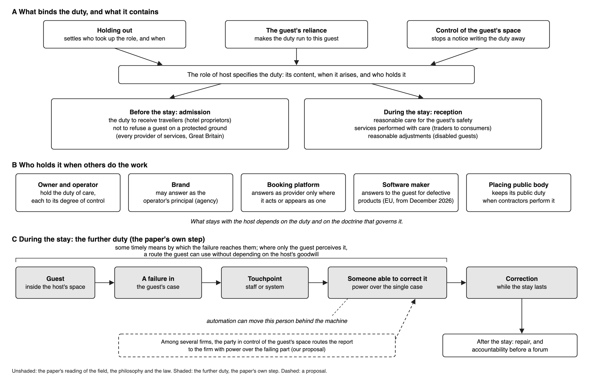

<!--
DRAFT_v10: the authors' DRAFT_v9 with targeted edits only (v10_2026-11/build_v10.py; every change listed in v10_2026-11/V10_CHANGES.md and marked in DRAFT_v10_marked.md). The title, Figure 1, the AI acknowledgment and the reference lists are copied from DRAFT_v8's assembly. Delete this comment before submission.
-->

# Who hosts the guest? Algorithmic mediation, standing and responsibility in phygital hospitality

## Abstract

Hotels and other commercial hosts increasingly hand off core parts of hosting, from setting room rates to checking guests in, to algorithms built and run by outside firms. When these systems fail, guests cannot always reach anyone with the authority to fix the problem. Hospitality scholars have long defined what a host owes a guest and noted that several firms can share the work of hosting, yet they rarely explain which firm owes what. We argue that the role of host carries two basic duties: keeping the guest safe and delivering promised services with care. A firm takes on these duties when it invites travellers in, earns their reliance, and controls the physical space, and it keeps the duty of care even when contractors or algorithms carry out the work. During a stay, the guest's claim also requires a timely route to reach someone who can correct a failure. In phygital hospitality, where digital systems mediate physical stays, automated processes must therefore remain interruptible. Drawing on hospitality scholarship, case law, and studies of automated hotels, the article maps how duties split across firms, offers seven questions for auditing a guest touchpoint, and outlines five stages from audit to accountability.

**Keywords:** phygital hospitality; algorithmic mediation; host duties; standing; interruptibility; accountability

## INTRODUCTION

In nine family-run hotels, eight of them at resort destinations, an outside revenue-management firm based in Europe supplied an algorithm that recommended nightly prices for every room (Garcia et al. 2026). Hotel managers kept the final say over rates and could log in each day to compare the suggested price against the posted one. Yet while the algorithm updated its recommendations weekly, managers adjusted prices only about once every 35 days. Because managers rarely intervened, the vendor had an incentive to design the pricing engine to exaggerate rate shifts – a feature the researchers describe as 'strategically biased' recommendations. When a manager manually changed a rate, every 1 per cent shift in the algorithm's recommendation moved the final price by an average of 0.72 per cent.

A second study shows digital technology working in the opposite direction. Batat (2021) examined Le Petit Chef, a three-dimensional animated chef projected onto restaurant tables to entertain diners while they wait for their food. Guests need no personal devices and make no technical effort to participate (Batat 2021: 4, 8). Nor do restaurant staff step back from the table. Instead, the projection sparks conversation among diners and between diners and servers, creating what one guest described as a great atmosphere with smiling staff (Batat 2021: 7, 8). Here, on our reading, digital media adds delight to the meal while human staff maintains discretion, and the basic rules of table service remain intact.

These two cases illustrate two distinct ways of combining physical and digital hospitality (Batat 2024: 1230–1231), and together they expose a central tension. At the restaurant, the staff who welcome and serve the diner remain within reach. At resort hotels, authority over the pricing rule shifts to a software model configured by an outside firm the guest never meets. Adding an external vendor to a hospitality operation is routine. The complication arises when algorithmic mediation separates the party that makes or shapes a decision from the party the guest can actually reach when something goes wrong.

Commercial lodging today routinely runs through several firms at once: the property that houses the guest, the brand on the sign, the platform that takes the booking, and the vendors whose systems set the price or unlock the door (Slattery 2002: 24–25; Cobbe et al. 2023: 1187). When a failure occurs at one of these touchpoints – an unexplained charge, a malfunctioning digital key, an unaddressed safety hazard – each firm can point to another, leaving the guest without an answerable counterparty. Shifting a hosting function into software does not dissolve the underlying duty owed to the guest. For that duty to hold in practice, it must remain attached to an identifiable party that can be reached and held to account during the stay.

This article examines what a commercial host owes a guest, why those obligations arise, and who holds them when hosting is split across multiple firms. Focusing primarily on lodging – though the framework may extend to other phygital services where several firms stand behind a single customer touchpoint – we advance three claims. First, the role of host itself defines two core duties: protecting the guest's safety and performing undertaken services with reasonable care. Second, three factual conditions bind those duties to a specific firm: holding itself out as open to travellers, earning the guest's reliance, and controlling the physical space. Even when contractors or algorithms carry out the work, spatial control keeps the duty of care with the host, and several parties may owe care simultaneously according to their degree of control. Third, the guest's claim during a stay grounds a further duty: the host must preserve a timely route through which a failure in the guest's case reaches someone empowered to correct it.

## THEORETICAL CONTEXT

### *Phygital hospitality*

Automated check-in is the clearest lodging example of what Batat terms 'phygital': 'a holistic and integrative ecosystem that adopts a consumer standpoint as a starting point and then integrates a combination of physical, human, digital and media content elements' (2024: 1229). A phygital service links physical spaces with digital interfaces, guides the guest between them, and promises 'a coherent continuum in the delivery process of consumer value' across the transition (Batat 2024: 1229). In hotels, this promise takes the form of mobile apps, automated kiosks, and pricing algorithms designed to make a stay faster and more tailored.

We use phygital hospitality to refer both to these technologies and to the multi-firm network operating behind them, which we call a phygital arrangement. Any moment where the guest interacts with that arrangement is a touchpoint. Rather than treating an algorithm as a standalone tool, we examine the broader socio-technical setup across which information, discretion, and decision-making power are distributed – spanning the guest, frontline staff, the property, software vendors, and corporate or platform rule-makers. Following Batat's treatment of AI 'not as a functional tool but as an "experiential agent"' (2026: 17), we view algorithmic systems as active mediators of the hospitality relationship. By redistributing knowledge and authority among these actors, technology alters the relationship itself rather than merely speeding up existing routines.

This perspective builds on Jennie Germann Molz's account of 'network hospitality', where digital platforms make hosting and guesting 'fluid and interchangeable', producing 'the phenomenon of "guests without hosts"' (2018: 231–232). Studying Airbnb, she notes that company lawyers argued: 'any penalty should be on the hosts renting out their homes, not on the company' (Mock, quoted in Germann Molz 2018: 244). In this journal, Germann Molz (2026) has already examined what happens when platforms push the human host out of sight. We take up the next step in that problem: when an algorithm takes over recognizing, routing, and admitting the guest, what happens to the duties the host used to owe?

Phygital arrangements operate through continuous translation: physical events become digital records, and digital outputs take effect as physical realities, such as a key card that unlocks a door or a room rate displayed at the front desk. While phygital frameworks describe this movement as fluidity (Batat and Hammedi 2023: 17; Batat 2024: 1220), calling it a relay exposes an operational question that fluidity obscures: who holds authority, and who retains room for judgement, at each handoff? Recent studies of 'robotic hospitableness' ask whether machines can make guests feel welcomed and reassured (Liu et al. 2026), and emerging work on AI consciousness asks whether guests can experience genuine hospitality from software at all (Lee and Lu 2024). Feeling welcomed, however, differs from occupying a relationship in which another party owes the guest enforceable care – a structural position that holds regardless of what the guest believes. Because a phygital relay can separate the firm that sets a rule from the firm facing the guest, it forces us back to a foundational question: who is the host?

### *The host*

Hospitality scholarship has long centred on what a host owes a guest. Kevin O'Gorman's history of ancient hospitality documents duties to receive travellers, protect them, and represent them in court when necessary (2005: 144–145), although Roman sources applied those obligations to private hosts rather than commercial innkeepers (2007: 45). Extending monastic principles from the Rule of St Benedict into modern commerce, Morrison and O'Gorman list protecting guests' health, safety, and security as core responsibilities of hospitality businesses (2008: Figure 2). Elizabeth Telfer, as Hemmington reports her, similarly treats guest safety as traditionally the host's primary obligation – one that Hemmington notes is frequently overlooked in commercial practice (2007: 15). Alongside obligation sits power. This journal's founding editorial frames hospitality as a mode of social control (Lynch et al. 2011), and Bulley traces how that control operates once guests cross the threshold (2015), echoing anthropologist Julian Pitt-Rivers's dictum that 'it is always the host who ordains, the guest who complies' (2012: 513). We read these accounts together as showing that admitting a guest entails assuming responsibility for their safety while exercising authority over the space for the duration of the stay. Experience research in the phygital tradition captures part of this bond by placing empathy and emotional connection at the centre of service design (Batat 2019). Yet, hospitality theory reminds us that warmth rests on a deeper structure of obligation – one that becomes critical as soon as the party admitting the guest is a machine.

At first glance, commercial lodging looks like ordinary customer service, and frontline workers often view it that way. When Golubovskaya et al. interviewed twenty-two hotel employees about their roles, only six could define hospitality; the rest defaulted to the language of service (2017: 1296). Some scholars doubt whether a host who charges can be hospitable at all, since commercial access ends the moment payment stops (Lashley 2015: 5), and Slattery argues that paying visitors 'are not guests, they are customers' (2002: 21). Service research has, on our reading, largely treated the frontline employee as the host (Odekerken-Schröder et al. 2022), conflating an employment role with an institutional obligation. Hospitality scholars have also shown that hosting splits across multiple actors – from micro-hosts and macro-hosts (Lynch et al. 2011) to relief agencies acting as an 'assembled host' in refugee camps (Bulley 2015), or asylum seekers housed in hotels who become simultaneous guests of the hotel, its staff, housing contractors, and the local community (Petie et al. 2025). These accounts leave unresolved which specific party owes the guest the host's core duties.

Retaining the term host remains essential despite these complications. The label can mislead when one firm presents itself as the host while another controls the room where the guest sleeps. Used precisely, however, host identifies who owes the guest care and who must answer when that care fails. Being a guest is a relational position, not a measure of service satisfaction. That position confers standing: the recognized status from which a person can make a request, raise an objection, ask for an exception, and expect a response. Defining who is host and what the host owes is therefore a question of duty rather than etiquette.

Standing differs from four related concepts in service and design research. Consumer rights are legal entitlements held against a firm whether or not anyone is present to honour them; procedural justice concerns how fairly a person perceives a process; contestability, as design work mostly uses it, refers to a technical mechanism for challenging an automated output; and customer participation describes the guest's own labour within the service – standing precedes all four. A guest has standing when their complaint counts as a claim addressed to a matching host who is bound to receive and answer it. That obligation rests on the host's role and the three factual conditions examined below; standing does not ground it but names the position the guest occupies when that obligation is recognized. Keeping four neighbouring terms distinct clarifies how algorithms disrupt this link: obligation is what the host owes the guest; responsibility is the task of fulfilling that obligation; authority is the power to alter a decision or the rule behind it; and accountability (or answerability) is the duty to explain and justify actions to someone entitled to ask (Bovens 2007). In a traditional face-to-face welcome, all four reside in one person. Algorithmic mediation pulls them apart, leaving the party with authority to change a rule insulated from the party required to answer the guest.

Recent hospitality and service studies approach this problem without resolving it. When, in their hypothetical case, undercooked burgers from a cooking robot sicken diners, Sharma and Mattila ask whether blame falls on the restaurant company, the robot manufacturer, the algorithm developers, or the manager on duty (2026: 911), ultimately leaving the question to governance and risk management (2026: 904). Other scholars prescribe practical safeguards, calling for 'a visible route to human assistance' in phygital hotels (Suh et al. 2026: sec. 6) or 'an identifiable actor authorized to complete recovery' within the organization the guest deals with (Ariyogi et al. 2026: 84, 78–79), while service research positions the focal firm as the orchestrator of its surrounding network (Wirtz et al. 2023). None of these frameworks derives what the guest is owed – or which firm owes it – from the role of host itself. To establish that link, we turn to the law of the host's duty.

### *The host's duty in law*

Common law has long tied the host's duty to a public act of invitation. William Blackstone wrote that anyone who 'hangs out a sign and opens his house for travellers' enters 'an implied engagement to entertain all persons who travel that way' (1768: 164), an obligation the law implies even without an explicit promise (161–163). Modern statute preserves that trigger: the Hotel Proprietors Act 1956 defines a hotel as an establishment 'held out by the proprietor' as offering food, drink, and sleeping accommodation to travellers (s. 1(3)).

Three factual conditions outside the role itself bind this duty to a specific firm: holding out, guest reliance, and control over the guest's space. Holding out – presenting a property to travellers as open to receive them – establishes who assumed the role and when; a modern English court applies this directly, holding that a hotel that 'invited guests to come and stay' thereby assumed a duty of reasonable care to protect them (Al-Najar 2019: para 187). Reliance connects that duty to the individual guest, as the Court of Appeal recognized in holding that a nightclub patron 'relies on the competence and prudence of its management' (Everett 2011: para 31). Control over the premises anchors the duty so it cannot be written away by fine print: as the same court noted, management controls who enters (Everett 2011: para 31), and in occupiers' liability law, Lord Pearson stated plainly that 'the foundation of occupier's liability is occupational control' (Wheat v E Lacon 1966). No single ground suffices on its own. An undertaking binds a host only to what it promised, reliance binds only towards those who actually relied, and vulnerability alone imposes duties only on whoever happens to be in a position to help (Jeske 2021: §§3–4, 7; Habib 2022: §§3.3, 5.1). When control over physical space combines with guest reliance, however, the host carries a duty of care for the guest's physical safety regardless of contractual disclaimers – a principle reflected in statutory bars against excluding liability for negligently caused death or personal injury (Consumer Rights Act 2015, s. 65).

Delegation complicates this picture because English law generally holds that a firm hiring an independent contractor does not answer for the contractor's wrongs (Barclays Bank v Various Claimants 2020: paras 7, 24, 27). Even so, the host does not disappear when outside contractors or automated vendors perform the work. Statute still assigns an innkeeper's duties to 'the proprietor' alone (Hotel Proprietors Act 1956, s. 1(1)); European package-travel law holds the tour organizer liable for contracted travel services regardless of who executes them (Directive (EU) 2015/2302, art. 13(1)); and occupiers continue to owe care according to their degree of control over the premises (Wheat v E Lacon 1966). Delegating operational tasks shifts some obligations while leaving others firmly with the host – making it necessary to distinguish which duties travel with the work and which stay behind.

Our purpose here is not to treat law as the moral foundation of hospitality. Rather, we read legal doctrine as an institutional record of what the role of host has been held to require across centuries of disputes. That record shows that the duty of care stays with the party controlling the guest's space, and it gives us a test for assigning duties when hosting is divided across multiple firms.

## APPROACH

We arrived at this question by reading phygital hospitality scholarship alongside published accounts of divided and automated lodging. Across those accounts, researchers kept encountering the same practical problem – who answers the guest when a system fails – while proposing operational safeguards without specifying which firm owes them or why. In every scenario, someone acted as host in practice, yet no party clearly bore the host's duties. To see whether existing work had resolved that gap, we searched OpenAlex, Crossref, and the web in November 2026 for studies explaining how duties divide among firms behind a stay; we found the problem widely noted but, in the literature we searched, never derived from the host role itself. We therefore assembled two bodies of material: judicial decisions and statutes from England and Wales, several United States jurisdictions, and the European Union, alongside published empirical studies of automated hotels in China, short-term rental platforms, algorithmically priced family hotels, and hotels housing state-placed asylum seekers. Rather than inventing hypothetical scenarios, we draw our cases directly from these published studies and legal judgments.

Reading these sources side by side showed that a host's obligations shift depending on the specific duty at issue and who controls the physical space. Because our argument is conceptual, these cases serve to illustrate analytical distinctions rather than test them as an empirical sample. Our claims also carry evidentiary and legal bounds. Outside European package-travel law, platform-moderation rules, disability-accommodation mandates, and the rules on solely automated decisions, the further duty we propose – preserving a timely route to someone who can correct a failure during the stay – is not yet required by law; existing doctrine generally offers remedies after the fact rather than an on-site route to repair. Our empirical evidence that hosts learn of individual failures primarily through guest reports also comes from two small hotel studies, and we rely on secondary accounts when reading Joseph Raz and Elizabeth Telfer.

Our method pairs a conceptual reading of hospitality theory with the law of delegation, treating each legal doctrine as evidence of what the role of host has historically been held to require. This approach rests on the premise that an institutional role defines the content of a duty, the moment it takes effect, and the party bound by it. At each organization and each guest touchpoint, we therefore ask where the host's duty sits and whether a failure in a guest's case can reach someone authorized to fix it. Throughout the analysis, we assume these obligations attach to the firm occupying the host role, not to the individual worker standing in the lobby.

## THE PARTIES TO A PHYGITAL ARRANGEMENT

Classical accounts of hospitality picture a single host who controls the house, sets its rules, and guarantees the guest's safety (Pitt-Rivers 2012: 513–514). In that model, the relationship runs along a direct line: the person who welcomes the traveller is also the person the traveller can address. Commercial lodging bends that line by placing a corporation and its frontline staff between the guest and the executives who write company policy, leaving the desk clerk to enforce rules they did not make. Phygital hospitality bends the line further by inserting software into the exchange. A guest's complaint must now travel through a longer chain, passing from guest to worker, from worker to software interface, and from interface to the outside firm that configured the model. At each step, the party facing the guest holds less of the authority needed to resolve the issue. These arrangements fail when the link between decision-making and answerability breaks down: the locus where a rule is set splits away from any point where a guest can get a response. To see where obligations remain intact and where they fracture, we examine each party in this chain, beginning with the property where the guest sleeps.

### *The property*

Hospitality law begins with the physical house itself. As Sandoval-Strausz notes, the traditional innkeeper received a stranger's person and belongings overnight inside a building that belonged to someone else (2005: 62–63). Under common law, a traveller turned away without cause could sue the innkeeper directly (Constantine 1944: 708), a general duty to receive that British statute still assigns to a hotel's proprietor (Hotel Proprietors Act 1956, s. 1(1)). Across Great Britain, providers of a service to the public are also barred from refusing service on any protected ground (Equality Act 2010, s. 29(1)). Once the property admits a guest, the host owes reasonable care for the guest's physical safety, including protection against foreseeable third-party crimes (Al-Najar 2019: paras 187, 240). Alongside safety sits contractual performance: a service provider must work 'with reasonable care and skill', and a consumer guest who receives substandard service can demand repeat performance (Consumer Rights Act 2015, ss. 49, 55).

When a property hires outside firms to maintain the building or staff its doors, liability narrows. Under English occupiers' law, an occupier is not liable for a contractor's faulty construction, maintenance, or repair if it selected a competent firm and took reasonable steps to verify the work (Occupiers' Liability Act 1957, s. 2(4)(b)). As Lord Keith observed, an occupier is not ordinarily expected to supervise a contractor it reasonably judges to be competent (Ferguson v Welsh 1987: 7). Courts have applied that rule to absolve both a nightclub that hired outside door security and a leisure centre whose exercise equipment was serviced by a contractor (Naylor v Payling 2004: paras 19, 50; Maguire v Sefton 2006: para 30). Non-delegable duties, which cannot be satisfied merely by hiring a careful contractor, remain what the UK Supreme Court calls 'exceptional' (Armes v Nottinghamshire 2017: para 32), and since the 1957 Act, absent contrary terms, a hotel's contract with its guest implies only the common duty of care (Maguire v Sefton 2006: paras 21–24). Whether an obligation remains with the property when work is outsourced thus turns on the specific duty at issue and the legal doctrine governing it.

Control over a property can also be shared across organizations. Ruling on a brewery-owned pub where the live-in manager's wife rented rooms to summer guests, Lord Denning noted that 'two or more may be "occupiers"', with each owing a duty of care 'dependent on his degree of control' (Wheat v E Lacon 1966). Inside the property itself, however, the internal authority to fix a guest's problem varies widely. At a small hotel in Helsinki, reception clerks could offer discounts without managerial approval. Yet, they hesitated to exceed 10 to 20 per cent of the room rate and did not know where their authority ended (Schumacher and Komppula 2016: 121–123). Similarly, reservation agents often hold formal latitude to accept rates below those suggested by revenue-management software. However, Bendoly (2013) notes that whether they exercise that discretion depends largely on their own judgement and how they expect supervisors to react. Algorithmic tools can strip away even that leeway, leaving frontline workers responsible for guest satisfaction without the controls needed to deliver it, much as Uber drivers found that routing software left them 'little flexibility for the driver to adapt to special client requests' (Möhlmann et al. 2021: 2009).

At the property level, legal doctrine anchors three duties: admitting travellers, protecting their physical safety, and delivering services with reasonable skill. Physical control over the premises keeps the duty of care attached to the property even when contractors perform operational tasks, and multiple parties can share that duty according to their degree of control. Yet operational reality inside the building often diverges from legal responsibility, leaving the employees who greet the guest with narrow or unclear authority to resolve problems.

### *The brand*

Hospitality scholarship has seldom examined what a hotel brand owes a guest when an independent franchisee or management company operates the property. Ariyogi et al. observe that guests evaluate service recovery through 'the branded service organization' they visibly deal with, even when outside vendors supply the underlying technology (2026: 78–79). Courts look past brand signage to two stricter tests: operational control and holding out. In Crinkley (1988: paras 9, 51), a jury held a motel franchisor vicariously liable under apparent agency because the company held the motel out as its own and kept a 'significant degree of control over the operation'. American courts have likewise treated a brand as the operator's legal principal where it holds 'the right to exercise control over the daily operations' (Billops 1978: 198), or where its public advertising promises travellers 'a certain level of service' (Orlando 1983: 494).

Conversely, brands avoid liability when both control and public reliance are absent. Courts have declined to hold franchisors liable where a licensing agreement required the local operator to display its own corporate identity. The guest had not selected the motel for its brand (Hayman v Ramada Inn 1987: 279), and a company's presence was limited to logos and branded products (Mobil Oil v Bransford 1995: 120–121). Liability follows actual operational control or public representation, not the sign above the entrance.

A hotel brand therefore answers to the guest only when it governs daily operations or holds itself out as the service provider. That same holding-out test determines responsibility when a guest books and enters a property through a digital platform.

### *The platform*

Short-term rental platforms illustrate how digital intermediaries fracture hosting. Studies of Airbnb and similar sites show property hosts struggling to satisfy opaque ranking algorithms (Cheng and Foley 2019), adjusting their homes to match platform-defined norms of hospitality (Roelofsen and Minca 2018; Germann Molz 2018), and accepting booking requests from guests with distinctively African-American names at lower rates (Edelman et al. 2017). Even as they shape these interactions, platforms seek to define accountability on their own terms, as seen in Airbnb's legal argument that penalties should fall solely on property owners rather than the company (Germann Molz 2018: 244).

European law draws the boundary of platform liability around how the service presents itself. The Court of Justice of the European Union held that a booking platform is not the underlying provider of accommodation when individual hosts set prices and the platform does not select who can list (Airbnb Ireland 2019: paras 56–57, 68). Under the Digital Services Act, however, an online marketplace loses its exemption from consumer-protection liability if an average consumer would reasonably believe the platform itself provides the service (Regulation (EU) 2022/2065, art. 6(3)). In daily practice, platform operations split the host role even further. Bosma reports that a single listing may divide tasks among a property owner, a primary host, and a co-host, including one co-host who took operational instructions directly from the mobile app rather than the owner (2022: 601), while self-check-in can replace the in-person key handover (2022: 605).

A platform thus incurs a host's obligations only when it presents itself to travellers as the accommodation provider. Otherwise, the duty of care remains with the party that controls the physical space, even if an app orchestrates the workers or property managers inside it. Behind both the booking app and the hotel's internal software sits another actor: the technology vendor.

### *The vendor*

Our opening vignette introduced one such vendor, whose software recommended nightly room rates while hotel managers retained final approval. When organizations delegate tasks to algorithmic systems, they redistribute three distinct capacities across firms: knowledge, discretion, and authority. Knowledge refers to who has the information needed to understand why an outcome occurred; discretion is the leeway to depart from a system's output in an individual case; and authority is the power to rewrite the underlying rule. In the hotel pricing study, the vendor held authority over the pricing algorithm. At the same time, managers kept discretion over individual room rates, though the researchers tracked managerial behaviour rather than guest complaints (Garcia et al. 2026). In daily operations, this split means a guest can easily reach a staff member with discretion over a single output, while never reaching the vendor who controls the rule.

Legal remedies against software vendors remain narrow. Under the revised EU Product Liability Directive, which applies to products placed on the market after 9 December 2026, a manufacturer of defective software answers directly to an injured guest, yet that liability covers only recognized categories of harm such as physical injury or property damage rather than ordinary service failures (Directive (EU) 2024/2853, arts 2(1), 4(1), 5(1), 6(1), 8(1)(a)). When multiple firms jointly deliver a service without forming a unified corporate principal, no single firm answers for the whole, because a loose supply chain does not constitute a single moral agent (Pettit 2007: 195).

The software vendor therefore governs the automated rule and faces direct guest liability only for specified physical or property harms, leaving the general duty of care with the party controlling the physical premises. As a result, the firm best positioned to understand an algorithmic error or revise its logic is often the party most insulated from the guest. We return to how guest complaints must reach the vendor when we examine the touchpoint, after considering one final party: the state.

### *The state*

State agencies enter the arrangement when public authorities place vulnerable residents in commercial hotels. In their study of asylum seekers housed in British hotels, Petie et al. (2025) show that residents placed on a no-choice basis became simultaneous guests of the hotel operator, frontline staff, private housing contractors, and the surrounding community. Hotel employees were abruptly cast as hosts for people whose legal and personal needs required expertise well beyond routine commercial lodging.

English courts divide responsibility in state-funded placements between public statutory duties and private spatial control. When a government minister houses asylum seekers through private contractors, the underlying statutory obligation is a public duty that 'remains hers' even when third parties execute the accommodation (R (DMA) 2020: para 100), which the Court of Appeal has interpreted as requiring a governance system to ensure contractors fulfil that duty rather than a freestanding obligation to monitor (RR v Enfield 2025: paras 80–81). At the same time, a private facility housing state-placed residents still owes direct duties to those residents 'governed by private law' (YL 2007: para 29).

Across all five parties (the property, the brand, the platform, the vendor, and the state), one rule recurs: physical control over the guest's space anchors the duty of care, and multiple organizations can share that duty according to their degree of control. Assigning responsibility for algorithmic and service failures beyond physical safety, however, requires moving beyond existing doctrine. Outside European package-travel rules, neither the law of delegation nor its moral philosophy obliges a delegator to maintain an active channel for discovering failures in an individual guest's stay while repair is still possible. In Brandt's account of moral delegation, a delegator must intervene once it becomes evident that a delegate is failing, yet maintaining a mechanism to detect those failures remains merely one optional policy among others (Brandt 2017). To see why a phygital host owes guests a dedicated route to correction, we must examine what happens during the stay itself.

## DURING THE STAY

Our opening cases also highlight the role of time. A room rate is set before arrival, and an animated projection accompanies a single meal. In contrast, a hotel stay unfolds across hours or nights inside premises the host controls (Pitt-Rivers 2012: 514). Walking out during a stay carries substantial financial and practical costs. Just as an au pair in Moysidou and Stanley's study kept quiet because she could not leave (2023), hotel guests rarely have an easy exit when an automated system fails. Once inside, Bulley observes, neither host nor guest can assert sovereignty without ending the relationship altogether (2015), which makes an effective complaint one of the guest's forms of power (Moysidou and Stanley 2023). Resolving a breakdown during the stay therefore depends on whether the guest's complaint reaches someone authorized to act.

A guest holds a direct claim-right to the host's promised performance and care, since legal duties owed to an identifiable person generate corresponding claims on that person's behalf (Constantine 1944: 708; Wenar and Cruft 2025: §2.1.2). We argue that this underlying claim generates a further duty during the stay. As Herstein reports in summarizing Joseph Raz's theory of rights, a single claim-right can seemingly justify new and shifting duties when factual circumstances change (2023: §8.4). Outsourcing and algorithmic mediation alter those circumstances: once service delivery runs through outside firms and automated interfaces, a host cannot meet its core obligations unless it can learn of a failure while repair is still possible. Under the principle of instrumental normativity, an 'ought' to achieve an end extends to the means necessary to achieve it (Kiesewetter 2015: 922). A phygital host must therefore preserve a timely channel for discovering and correcting failures during the stay, even though no single technical design is required.

When a failure is visible only to the guest, an accessible reporting route becomes essential. Hotels often rely on guests to surface operational breakdowns. Staff at a Helsinki hotel depended primarily on guest feedback to spot service lapses (Schumacher and Komppula 2016: 121), and guests whom self-service kiosks failed to process at automated hotels in China had to find a worker (Xu and Greiffenhagen 2024: 5035). Yet relying solely on spontaneous complaints has clear limits: customers who feel low in power are less likely to complain (Min and Kim 2020: 2), while system-wide outages require no individual report to detect (Xu and Greiffenhagen 2024: 5021). Although evidence from these two small hotel studies is limited, it indicates that guest reporting is the main way hosts learn of individual failures, if not the only one. Because the guest remains subject to the host's control of the premises and faces high costs to leave, the guest must be able to use that reporting route as a matter of right rather than depending on the host's goodwill.

Because the guest's underlying claim justifies this duty, it is owed directly to the guest, even if dynamic duties generated by changing facts complicate strict correlativity between rights and obligations (Herstein 2023: §8.4). This obligation differs from Hindriks's collective 'duty of control', which rests partly on general risk to others and which he does not say is owed to anyone (2025: 4–5). It also differs from commercial service recovery, which treats complaint handling as a strategy for protecting customer satisfaction and loyalty (Gelbrich and Roschk 2011), because the host's duty binds even when retaining the guest is unprofitable. A host that maintains no channel for on-site correction wrongs its guests even if nothing goes wrong during their visit. Design scholars have already recommended building human escalation paths into automated services (Ariyogi et al. 2026: 84; Suh et al. 2026: sec. 6); our contribution is to establish why the guest is owed that route and which party must provide it.

This further duty lasts for the duration of the stay, matching the period of the guest's subjection to the host's space. Within that window, the route exists to deliver correction, meaning late performance or the on-site repair of a lapse. Once the stay ends, the guest's claims shift towards financial compensation and formal accountability, which Fox, following Schedler, defines as the capacity to demand answers and impose sanctions (2007: 665). While Baum and Laux observe that runtime oversight can alter an automated decision only before that decision takes effect (2026: 120–122), hospitality requires a broader window: the reporting route is owed for as long as correction can still help the guest during the stay. Several European and British statutes prioritize live repair over post-hoc payment, requiring package-travel organizers to remedy defects during a trip, service providers to repeat substandard work, and digital platforms to rectify automated worker decisions or, where that is impossible, to compensate (Directive (EU) 2015/2302, art. 13; Consumer Rights Act 2015, ss. 55, 56(3); Directive (EU) 2024/2831, art. 11(3)). Table 1 maps common hospitality encounters against this boundary.

**Table 1.** Hospitality decisions by whether correction during the stay can help, and the route each requires.

| Decision | When its effect lands | Can correction during the stay help? | Route required by the further duty | Source |
|---|---|---|---|---|
| Refusal at arrival | Before reception | Yes, if someone can admit the guest that night | None from the further duty; governed by the innkeeper's duty to receive and non-discrimination law | Hotel Proprietors Act 1956, s. 1; Equality Act 2010, s. 29(1) |
| Identity or booking not recognized at check-in | At arrival | Yes | An immediately reachable worker or process authorized to override the system | Xu and Greiffenhagen 2024: 5035 |
| Safety hazard on the premises | During the stay | Yes, while the guest remains exposed | An on-site staff member empowered to intervene | Authors' analysis |
| In-room service failure | During the stay | Yes | A disclosed reporting route ending with someone able to fix the issue that day | Authors' analysis |
| Disputed charge during the stay | At payment | In part | A reporting route during the stay; financial refund or adjustment afterwards | Authors' analysis |

This temporal boundary also clarifies why studies of guest acceptance of hotel automation require careful interpretation. Guests may care little whether a human clerk or a lobby robot gives them directions (Schmidt et al. 2025), on our reading because the stakes of that exchange are low. What matters is the authority exercised and the consequences riding on each specific encounter. On this reading, friction is valuable because it creates a pause in which a guest can exercise standing.

## AT THE TOUCHPOINT

Phygital hospitality ultimately turns on what happens at the touchpoint itself. A facial-recognition kiosk in a lobby or a numeric keypad on a rental door bridges digital computation and the physical room the guest inhabits. Like the division of parties and the duration of the stay, the touchpoint is where a host's duty is either fulfilled or broken (Figure 1).

**Figure 1.** The host's duty, its holders, and the further duty during the stay.

Automated check-in shows how easily that duty can slip out of reach. At two automated hotels in China studied by Xu and Greiffenhagen, service workers remained on site for legal and technical reasons even though guests were expected to register on their own (2024: 5035). Guests walked past staff to use the lobby kiosks, and anyone who approached a worker first was told to 'do it yourself' (5022). Guests whom the kiosk failed to process reached a staff member only by actively tracking one down (5035). Automation did not remove the person with authority from the building, yet it pushed that person behind the machine. Whether an encounter happens at a Helsinki front desk or through a short-term rental app, every touchpoint faces the same practical test: can a failure in an individual guest's case reach someone with power to resolve it?

That reporting route does not always have to end with a human. At the automated hotels in China, every facial-recognition error cleared up when guests stepped back and tried again (Xu and Greiffenhagen 2024: 5025, 5027, 5030). When retrying cannot help, however, repair requires the authority to override the software's output, as when a clerk manually checked in the thirteen guests whom the kiosk could not process (5035). For recurring, documented errors, building in a reachable override is a basic precaution any host can anticipate (Kong 2026: 6). When an unforeseen breakdown carries serious stakes for the guest, a natural person needs to sit at the end of the line. European law reflects this distinction only partially: starting 2 December 2027, high-risk AI systems listed in Annex III of the EU AI Act must allow human overseers, as appropriate and proportionate, to 'disregard, override or reverse the output', yet the law excludes systems used solely to verify a person's identity (Regulation (EU) 2024/1689, arts 14(4), 113, as amended by Regulation (EU) 2026/1744; Annex III, point 1(a)). The host must also ensure that whoever holds that override power exercises it with reasonable care. In Westin Operator v Groh, intoxicated guests told a hotel security guard they were too drunk to drive, and the guards evicted them anyway; the Colorado Supreme Court held that the hotel's duty of care governed how it ended the stay (2015: ¶¶ 4, 7).

A reporting route works only if the host gives the person at the end of it genuine authority, unlike the unwritten, ambiguous discretion left to receptionists at the Helsinki hotel. Putting a human in the loop accomplishes little if that worker can offer sympathy but lacks the power to change a booking, a charge, or an access code (Sterz et al. 2024: 2498; Li and Sun 2025). Giving a guest a friendly face to vent to is no substitute for an accountable counterparty. To make a route effective, the host must grant override authority in writing, train staff to use it, and shield frontline workers from absorbing blame for systemic flaws they cannot fix. Training builds competence, whereas organizational rules confer authority. The host must also track complaints across individual stays, since recurring glitches often signal broader design defects; as the UN Guiding Principles observe, analysing complaint patterns turns a grievance channel into 'a source of continuous learning' (United Nations 2011: 32, 34). Where multiple firms divide the work of hosting, the organization controlling the physical space should route each complaint to whichever partner governs the failing component. Lord Denning offered an early parallel in occupiers' liability law, noting that if pub managers realized a handrail was unsafe, they should have reported it to the brewery that owned the building (Wheat v E Lacon 1966).

These requirements yield a diagnostic test for researchers studying phygital services and for hosts auditing their own properties: can a failure in a guest's case reach someone able to correct it in time? The audit follows the path a guest's complaint must travel:

1. Who detects a failure in the guest's case: the guest, the staff, or the automated system?
2. Is the guest informed of a reporting route, and can the guest use it without relying on the host's goodwill or incurring an unfair penalty?
3. Where does the route end, and can the person or process there depart from the system's output in that specific case?
4. Is that override power real, backed by written authority, staff training, and institutional protection?
5. Can the report arrive, and can correction occur, while the stay still allows a meaningful remedy?
6. Does the host learn across accumulated cases, and when several firms share the stay, does one party route reports to the responsible partner?
7. After the stay ends, who must answer if the outcome remains in dispute?

Applying these questions shows where a touchpoint breaks down. At automated hotels in China, the escalation path ended with a clerk able to check guests in by hand, yet guests the kiosk could not process had to find that worker themselves; the arrangement passes the third question while failing the second (Xu and Greiffenhagen 2024: 5035). In Groh, by contrast, the guests' plea reached security guards who held authority over the premises. Yet Groh alleged those guards lacked training to handle intoxicated patrons safely (Westin Operator v Groh 2015: ¶¶ 7–8, 13, 36). On those allegations, the hotel passes the third question and fails the fourth. A reporting route can exist on paper and still fail at a different link in every case.

Existing law sets only a minimal floor beneath this audit. In the European Union, decisions based solely on automated processing that carry significant effects are generally prohibited outside narrow statutory exceptions (SCHUFA 2023: paras 52–53), and online platforms must maintain a contact channel that does not 'solely rely on automated tools' (Digital Services Act, art. 12(1)). In Great Britain, disability law may entitle a disabled guest to human assistance if a self-service kiosk or mobile app creates a substantial disadvantage (Equality Act 2010, s. 20(5), (6), (11)). Outside package travel, platform moderation, and solely automated significant decisions, no statute or judgment we reviewed grants an overnight guest a general right to reach a person empowered to override an automated outcome. Nor, on our reading, does the lack of a reporting route create a separate legal claim where a firm already answers for defective performance, as a tour operator did in X v Kuoni (2021: para 50). Just as the Georgia Supreme Court left any affirmative duty to check on guests to the state legislature (Rasnick 2011: 569), the further duty we propose remains a normative guide for lawmakers and hospitality operators rather than settled law.

This analysis also challenges a central ideal in phygital hospitality scholarship: 'seamlessness'. Design frameworks treat smoothness as a central goal of automated service, stripping away queues, repetition, and hesitation so guests glide through a stay (Batat and Hammedi 2023; Batat 2024; Mameli et al. 2026). Some scholars have begun questioning that priority. Shabnam et al. critique the field's 'dominant emphasis on efficiency and experience design' (2026: 2), and Batat ranks systems that create 'seamless, efficient, and coherent phygital journeys' below AI aligned with deeper human values (2026: 13, 16). Negotiation requires a moment in which negotiation can take place, and an interface engineered never to interrupt the guest easily becomes an interface the guest cannot interrupt. The alternative to frictionless service is interruptible hospitality: an arrangement that lets the guest pause the automated flow, ask a question, or request an exception, with an accountable counterparty ready to catch the interruption. Preserving trust across a digital crossing, which the phygital literature rightly seeks, requires ensuring that whoever could answer the guest before automation can still be reached after it. Interruptibility is the practical design consequence of the host's further duty.

Explaining an automated decision, letting guests flag data errors, and disclosing rule changes all improve user experience, yet none settles who is answerable when a system fails. An escalation option that exists on paper but imposes steep costs in money, effort, or embarrassment offers no real alternative, and walking away from an app-gated service 'may carry a personal cost and loss' (Wilson-Nash et al. 2026: 979). When a guest's body, identification documents, language, or immediate circumstances fall outside a software model's assumptions, the guest confronts an interface with no surface for negotiation. Table 2 organizes these obligations into five stages for hosts, culminating in post-stay accountability before an institutional forum that can ask questions and pass judgement (Bovens 2007: 450). Such a forum, on our account, provides an official venue where a guest can lodge a claim, an obligated party must respond with reasons, authority exists to revise the outcome, and responsibility is formally recorded. For a small innkeeper, meeting the first four stages can be as straightforward as posting a phone number that the owner actually answers.

**Table 2.** Five stages from touchpoint audit to post-stay accountability (the order is ours).

| Stage | What the host does | What it secures for the guest |
|---|---|---|
| 1. Examine | Applies the seven diagnostic questions to each touchpoint | A clear map of where a failure in a guest's case can and cannot reach someone able to fix it |
| 2. Tell | Discloses the reporting route in formats every guest can use | A known path to help that does not require a confrontation or depend on the host's goodwill |
| 3. Empower | Grants the person at the route's end written authority, training, and protection | An accessible counterparty genuinely able to correct the failure during the stay |
| 4. Learn and route | Tracks complaints across stays and routes multi-firm failures to the responsible partner | Correction of recurring system flaws and breakdowns in another firm's component |
| 5. Answer | Responds after the stay before a forum authorized to question and judge | Formal accountability for lapses that went uncorrected during the visit |

## CONCLUSION

This article has advanced three connected claims about responsibility in phygital hospitality. First, the institutional role of host defines two core obligations: protecting the guest's safety and performing undertaken services with reasonable care. Second, three factual conditions (holding a property out to travellers, earning the guest's reliance, and controlling the physical space) bind those duties to a specific organization. Spatial control keeps the duty of care with the host even when outside contractors or algorithms do the work, and multiple parties can owe care at once, according to their degree of control. Third, during a stay, the guest's claim grounds a further duty to preserve a timely route through which a breakdown reaches someone empowered to fix it. Algorithmic mediation leaves these underlying duties intact even when it moves the person with authority behind a screen, as the automated check-in kiosks in China illustrate.

Recognizing these obligations leaves ample room for automation in lodging. Phygital systems can improve responsiveness and allow small teams to serve far more guests, though experts expect algorithmic management also to intensify frontline hotel work (Jianu et al. 2025: 1, 6). Making automated hospitality genuinely human-centred requires keeping an answerable counterparty within reach rather than keeping every interaction face-to-face. When a system malfunctions or a guest's circumstances fall outside its rules, human-centricity depends on whether the guest can reach someone with the authority to intervene. Supplying that reachable counterparty is the core purpose of the further duty.

As automated systems take on tasks once performed by innkeepers and clerks, the central governance challenge is keeping every hosting obligation anchored to an identifiable firm. Multiple organizations converge on a single guest touchpoint, yet each carries a distinct legal and moral share of the encounter. The property owes physical care because it controls the premises where the guest sleeps, while a hotel brand answers when it directs daily operations or holds itself out as the provider. A booking platform assumes host duties only when it presents itself as the accommodation supplier; a software vendor governs the automated rules and answers directly to guests only for covered physical or property damage; and the state retains its public duties towards residents it places in hotels. Hospitality breaks down when operational tasks scatter across these actors while answerability loses a clear address.

Policy frameworks and AI ethics scholarship point in a similar direction without grounding these safeguards in the role of host. The UN Guiding Principles call for grievance channels directly accessible to anyone a business may harm (United Nations 2011: 31–32), the White House Office of Science and Technology Policy recommends 'access to a person who can quickly consider and remedy problems' (2022: 46), and Binesh and Syah argue that protecting guest autonomy requires 'real human override at the service encounter' (2026: 10). What this article adds is a derivation of that escalation route directly from the host's underlying duty, assigning responsibility for providing it to whichever organization controls the physical space. In this journal, Germann Molz asked whether digital platforms 'are held accountable' for the social effects of network hospitality (2018: 246). For a guest staying inside commercial premises, accountability runs through control of that space.

Four studies would test this framework where its empirical and doctrinal footing is thinnest. First, hotel surveys and observational studies should measure how often guests report failures during a stay, whom they turn to, and through which channels. Second, comparative service studies should test whether recovery after a kiosk or robot breakdown differs when guests can reach an authorized on-site employee versus when they cannot. Third, process-tracing research in unstaffed hotels and self-check-in rentals should follow guest complaints across partner firms and measure the time required to correct them. Fourth, legal analysis should examine whether courts treat the absence of any on-site reporting route as a failure of reasonable care. Because the further duty governs live repair during the stay, disputed complaints afterwards still require an independent forum, since a business 'cannot, with legitimacy, both be the subject of complaints and unilaterally determine their outcome' (United Nations 2011: 35).

Commercial hosts do not need to wait for new legislation to act on these principles. Operators can audit every guest touchpoint using the seven diagnostic questions, tell guests clearly and accessibly how to reach help, grant frontline workers written authority to override automated errors, and accept institutional responsibility for the rules their software enforces. Across arrangements that divide hosting among staff, software, and partner firms, the decisive test is whether a failure in a guest's case can still reach someone empowered to fix it. However intelligent, personalized, or effortless the technology becomes, someone still owes the guest a welcome.

## Acknowledgment of the Use of Generative AI and AI-Assisted Technologies in the Writing Process

Throughout the preparation of this work, the authors employed Claude (Anthropic; Fable 5.2 and Opus 5.5) to search for and read sources, check citations and quotations, and draft the revised article and the responses to reviewers. Following the utilization of this tool/service, the authors thoroughly reviewed and edited the content as necessary, assuming full responsibility for the publication's content.

## References

Ariyogi, Dila, Mulyawan, Ulfan and Junita, Mawar (2026), 'From AI disclosure to human handoff: Transparency, trust, and accountability in automated hospitality services—A structured evidence review', *Global Review of Tourism and Social Sciences*, 3:1, pp. 77–90.

Batat, Wided (2019), *Experiential marketing: Consumer behavior, customer experience and the 7Es*, London: Routledge.

Batat, Wided (2021), 'How augmented reality (AR) is transforming the restaurant sector: Investigating the impact of "Le Petit Chef" on customers' dining experiences', *Technological Forecasting and Social Change*, 172, 121013.

Batat, Wided (2024), 'What does phygital really mean? A conceptual introduction to the phygital customer experience (PH-CX) framework', *Journal of Strategic Marketing*, 32:8, pp. 1220–1243.

Batat, Wided (2026), 'The phygital intelligence value experience (PHIVE) matrix: The good, the bad, and the ugly of AI marketing for customer experience design', *Journal of Strategic Marketing*, pp. 1–21.

Batat, Wided and Hammedi, Wafa (2023), 'The extended reality technology (ERT) framework for designing customer and service experiences in phygital settings: A service research agenda', *Journal of Service Management*, 34:1, pp. 10–33.

Baum, Kevin and Laux, Johann (2026), 'Constitutive vs. corrective: A causal taxonomy of human runtime involvement in AI systems', in *Bridging the Gap Between AI and Reality*, Cham: Springer Nature Switzerland, pp. 115–130.

Bendoly, Elliot (2013), 'Real-time feedback and booking behavior in the hospitality industry: Moderating the balance between imperfect judgment and imperfect prescription', *Journal of Operations Management*, 31:1–2, pp. 62–71.

Binesh, Nasim and Syah, Ahmad (2026), 'AI ethics in hospitality and tourism: Theoretical perspectives, ethical beliefs, and actionable outcomes', *Frontiers in Artificial Intelligence*, 9, 1913343.

Blackstone, William (1768), *Commentaries on the laws of England*, vol. 3, Oxford: Clarendon Press.

Bosma, Jelke R. (2022), 'Platformed professionalization: Labor, assets, and earning a livelihood through Airbnb', *Environment and Planning A: Economy and Space*, 54:4, pp. 595–610.

Bovens, Mark (2007), 'Analysing and assessing accountability: A conceptual framework', *European Law Journal*, 13:4, pp. 447–468.

Brandt, Reuven (2017), 'The transfer and delegation of responsibilities for genetic offspring in gamete provision', *Journal of Applied Philosophy*, 34:5, pp. 665–678.

Bulley, Dan (2015), 'Ethics, power and space: International hospitality beyond Derrida', *Hospitality & Society*, 5:2–3, pp. 185–201.

Cheng, Mingming and Foley, Carmel (2019), 'Algorithmic management: The case of Airbnb', *International Journal of Hospitality Management*, 83, pp. 33–36.

Cobbe, Jennifer, Veale, Michael and Singh, Jatinder (2023), 'Understanding accountability in algorithmic supply chains', *Proceedings of the 2023 ACM Conference on Fairness, Accountability, and Transparency (FAccT '23)*, pp. 1186–1197.

Edelman, Benjamin, Luca, Michael and Svirsky, Dan (2017), 'Racial discrimination in the sharing economy: Evidence from a field experiment', *American Economic Journal: Applied Economics*, 9:2, pp. 1–22.

Fox, Jonathan (2007), 'The uncertain relationship between transparency and accountability', *Development in Practice*, 17:4–5, pp. 663–671.

Garcia, Daniel, Tolvanen, Juha and Wagner, Alexander K. (2026), 'Strategic responses to algorithmic recommendations: Evidence from hotel pricing', *Management Science*, 72:1, pp. 609–626.

Gelbrich, Katja and Roschk, Holger (2011), 'A meta-analysis of organizational complaint handling and customer responses', *Journal of Service Research*, 14:1, pp. 24–43.

Germann Molz, Jennie (2018), 'Discourses of scale in network hospitality: From the Airbnb home to the global imaginary of "belong anywhere"', *Hospitality & Society*, 8:3, pp. 229–251.

Germann Molz, Jennie (2026), 'Guests without hosts: On the digital biopolitics of network hospitality', *Hospitality & Society*, 16:1, pp. 63–82.

Golubovskaya, Maria, Robinson, Richard N.S. and Solnet, David (2017), 'The meaning of hospitality: Do employees understand?', *International Journal of Contemporary Hospitality Management*, 29:5, pp. 1282–1304.

Habib, Allen (2022), 'Promises', in Zalta, Edward N. and Nodelman, Uri (eds), *The Stanford Encyclopedia of Philosophy*, Metaphysics Research Lab, Stanford University.

Hemmington, Nigel (2007), 'From service to experience: Understanding and defining the hospitality business', *The Service Industries Journal*, 27:6, pp. 747–755.

Herstein, Ori (2023), 'Legal rights', in Zalta, Edward N. and Nodelman, Uri (eds), *The Stanford Encyclopedia of Philosophy*, Metaphysics Research Lab, Stanford University.

Hindriks, Frank A. (2025), 'The moral failures of collective agents: Responsibility voids and control gaps', *Synthese*, 205:4, 145.

Jeske, Diane (2021), 'Special obligations', in Zalta, Edward N. (ed.), *The Stanford Encyclopedia of Philosophy*, Metaphysics Research Lab, Stanford University.

Jianu, Brana, Ashton, Mark and Lugosi, Peter (2025), 'Integrating algorithmic management in hotels: Emerging challenges and opportunities for frontline managers', *International Journal of Hospitality Management*, 129, 104168.

Kiesewetter, Benjamin (2015), 'Instrumental normativity: In defense of the transmission principle', *Ethics*, 125:4, pp. 921–946.

Kong, Kennedy Chun Yin (2026), 'The delegation illusion: Why deploying autonomous AI agents does not diminish principal responsibility', *AI and Ethics*, 6:5, 518.

Lashley, Conrad (2015), 'Hospitality and hospitableness', *Research in Hospitality Management*, 5:1, pp. 1–7.

Lee, Wangoo and Lu, Lu (2024), 'The hospitable thought that counts: An emerging theory of "AI consciousness" in genuine hospitality', *International Journal of Hospitality Management*, 123, 103928.

Li, Huanhuan and Sun, Zongfeng (2025), 'Is algorithmic accessibility sufficient? The pivotal role of accessibility and accountability in shaping trust in automated decision-making', *Governance*, 38:4, e70067.

Liu, Gus Guanrong, Benckendorff, Pierre and Walters, Gabby (2026), 'Conceptualizing hospitableness in human-robot hospitality interactions', *International Journal of Hospitality Management*, 135, 104640.

Lynch, Paul, Germann Molz, Jennie, McIntosh, Alison, Lugosi, Peter and Lashley, Conrad (2011), 'Theorizing hospitality', *Hospitality & Society*, 1:1, pp. 3–24.

Mameli, Elisa, Scarles, Caroline, Stangl, Brigitte and Frohlich, David (2026), 'A comprehensive framework for phygital tourism experiences: Bridging academic insights and industry practices across sectors', *Information Technology & Tourism*, 28:1, 19.

Min, Hyounae (Kelly) and Kim, Hyun Jeong (2020), 'Do all angry customers complain?', *ICHRIE Research Reports*, 5:1, 2.

Möhlmann, Mareike, Zalmanson, Lior, Henfridsson, Ola and Gregory, Robert Wayne (2021), 'Algorithmic management of work on online labor platforms: When matching meets control', *MIS Quarterly*, 45:4, pp. 1999–2022.

Morrison, Alison and O'Gorman, Kevin (2008), 'Hospitality studies and hospitality management: A symbiotic relationship', *International Journal of Hospitality Management*, 27:2, pp. 214–221.

Moysidou, Gesthimani and Stanley, Phiona (2023), 'Theorizing gender in homestay settings: Mobilities and/as power relations', *Hospitality & Society*, 13:3, pp. 241–263.

O'Gorman, Kevin D. (2005), 'Modern hospitality: Lessons from the past', *Journal of Hospitality and Tourism Management*, 12:2, pp. 141–151.

O'Gorman, Kevin D. (2007), 'Discovering commercial hospitality in ancient Rome', *Hospitality Review*, 9:2, pp. 44–52.

Odekerken-Schröder, Gaby, Mennens, Kars, Steins, Mark and Mahr, Dominik (2022), 'The service triad: An empirical study of service robots, customers and frontline employees', *Journal of Service Management*, 33:2, pp. 246–292.

Petie, Olivia, Phillimore, Jenny and Allsopp, Jennifer (2025), 'Exploring hospitality, hostility and (un)home in hotel accommodation for asylum seekers in the United Kingdom', *Hospitality & Society*, 15:1, pp. 23–44.

Pettit, Philip (2007), 'Responsibility incorporated', *Ethics*, 117:2, pp. 171–201.

Pitt-Rivers, Julian (2012), 'The law of hospitality', *HAU: Journal of Ethnographic Theory*, 2:1, pp. 501–517.

Roelofsen, Maartje and Minca, Claudio (2018), 'The superhost: Biopolitics, home and community in the Airbnb dream-world of global hospitality', *Geoforum*, 91, pp. 170–181.

Sandoval-Strausz, A. K. (2005), 'Travelers, strangers, and Jim Crow: Law, public accommodations, and civil rights in America', *Law and History Review*, 23:1, pp. 53–94.

Schmidt, Alexander Lennart, Koerten, Klaas, Tuomi, Aarni, El-Manstrly, Dahlia and Wiegerink, Karoline (2025), 'Human versus robot: Comparing service agents in hospitality settings — insights from a field study', *Strategic Change*, 34:4, pp. 559–575.

Schumacher, Satu and Komppula, Raija (2016), 'A case study on service recovery: Frontline employees' perspectives and the role of empowerment', *European Journal of Tourism, Hospitality and Recreation*, 7:2, pp. 117–127.

Shabnam, Saadia, Roy, Sanjit Kumar, Roten, Yonathan Silvain, Singh, Gaganpreet, Suh, Taewon and Li, Hairong (2026), 'Transformative phygital service research (TPSR): An agenda for future research', *Journal of Services Marketing*, pp. 1–17.

Sharma, Amit and Mattila, Anna S. (2026), 'Rights and responsibilities of hospitality service robots', *Journal of Hospitality & Tourism Research*, 50:6, pp. 904–920.

Slattery, Paul (2002), 'Finding the hospitality industry', *Journal of Hospitality, Leisure, Sport and Tourism Education*, 1:1, pp. 19–28.

Sterz, Sarah, Baum, Kevin, Biewer, Sebastian, Hermanns, Holger, Lauber-Rönsberg, Anne, Meinel, Philip and Langer, Markus (2024), 'On the quest for effectiveness in human oversight: Interdisciplinary perspectives', *Proceedings of the 2024 ACM Conference on Fairness, Accountability, and Transparency*, pp. 2495–2507.

Suh, Taewon, Nasta, Luigi, Pirolo, Luca and Magnanelli, Barbara Sveva (2026), 'Phygital customer experience and the adoption of immersive technologies in hospitality: An exploratory study with a value co-creation perspective', *Journal of Services Marketing*, pp. 1–18.

United Nations, Office of the High Commissioner for Human Rights (2011), *Guiding principles on business and human rights: Implementing the United Nations "protect, respect and remedy" framework*, https://www.ohchr.org/sites/default/files/documents/publications/guidingprinciplesbusinesshr_en.pdf.

Wenar, Leif and Cruft, Rowan (2025), 'Rights', in Zalta, Edward N. and Nodelman, Uri (eds), *The Stanford Encyclopedia of Philosophy*, Metaphysics Research Lab, Stanford University.

White House Office of Science and Technology Policy (2022), *Blueprint for an AI bill of rights: Making automated systems work for the American people*, The White House, https://bidenwhitehouse.archives.gov/wp-content/uploads/2022/10/Blueprint-for-an-AI-Bill-of-Rights.pdf.

Wilson-Nash, Carolyn, Angell, Rob, Qiu, Yuanming, Pavlopoulou, Ismini and Kolyperas, Dimitrios (2026), 'No app, no entry: Conceptualizing digital technology captivity in service access', *Psychology & Marketing*, 43:5, pp. 974–985.

Wirtz, Jochen, Kunz, Werner H., Hartley, Nicole and Tarbit, James (2023), 'Corporate digital responsibility in service firms and their ecosystems', *Journal of Service Research*, 26:2, pp. 173–190.

Xu, Xinzhi and Greiffenhagen, Christian (2024), 'The disciplined customer: A video-based study of automated self-service hotels', *New Media & Society*, 26:9, pp. 5013–5038.

### Cases

Airbnb Ireland (2019), Case C-390/18, criminal proceedings against X (Airbnb Ireland), judgment of the Court (Grand Chamber) of 19 December 2019.

Al-Najar v The Cumberland Hotel (London) Ltd [2019] EWHC 1593 (QB).

Armes v Nottinghamshire County Council [2017] UKSC 60.

Barclays Bank plc v Various Claimants [2020] UKSC 13.

Billops v Magness Construction Co (1978) 391 A.2d 196 (Del.).

Constantine v Imperial Hotels Ltd [1944] 1 KB 693.

Crinkley v Holiday Inns, Inc (1988) 844 F.2d 156 (4th Cir.).

Everett v Comojo (UK) Ltd [2011] EWCA Civ 13, [2012] 1 WLR 150.

Ferguson v Welsh [1987] UKHL 14, [1987] 1 WLR 1553.

Hayman v Ramada Inn, Inc (1987) 86 N.C. App. 274.

Maguire v Sefton Metropolitan Borough Council [2006] EWCA Civ 316.

Mobil Oil Corp v Bransford (1995) 648 So. 2d 119 (Fla.).

Naylor (t/a Mainstreet) v Payling [2004] EWCA Civ 560.

Orlando Executive Park, Inc v Robbins (1983) 433 So. 2d 491 (Fla.).

R (DMA) v Secretary of State for the Home Department [2020] EWHC 3416 (Admin).

R (RR) v London Borough of Enfield [2025] EWCA Civ 1390.

Rasnick v Krishna Hospitality, Inc (2011) 289 Ga. 565, 713 S.E.2d 835.

SCHUFA: OQ v Land Hessen (2023), Case C-634/21, judgment of the Court (First Chamber) of 7 December 2023.

Westin Operator, LLC v Groh 2015 CO 25, 347 P.3d 606 (Colo.).

Wheat v E Lacon & Co Ltd [1966] UKHL 1, [1966] AC 552.

X v Kuoni Travel Ltd [2021] UKSC 34.

YL v Birmingham City Council [2007] UKHL 27.

### Legislation and other legal sources

Consumer Rights Act 2015 (c. 15).

Directive (EU) 2015/2302 of the European Parliament and of the Council of 25 November 2015 on package travel and linked travel arrangements.

Directive (EU) 2024/2831 of the European Parliament and of the Council of 23 October 2024 on improving working conditions in platform work.

Directive (EU) 2024/2853 of the European Parliament and of the Council of 23 October 2024 on liability for defective products.

Equality Act 2010 (c. 15).

Hotel Proprietors Act 1956 (4 & 5 Eliz. 2 c. 62).

Occupiers' Liability Act 1957 (5 & 6 Eliz. 2 c. 31).

Regulation (EU) 2022/2065 of the European Parliament and of the Council of 19 October 2022 on a Single Market for Digital Services (Digital Services Act).

Regulation (EU) 2024/1689 of the European Parliament and of the Council of 13 June 2024 laying down harmonised rules on artificial intelligence (Artificial Intelligence Act), OJ L, 12.7.2024.

Regulation (EU) 2026/1744 of the European Parliament and of the Council of 8 July 2026 amending Regulations (EU) 2024/1689, (EU) 2018/1139 and (EU) 2023/1230 as regards the simplification of the implementation of harmonised rules on artificial intelligence (Digital Omnibus on AI).
