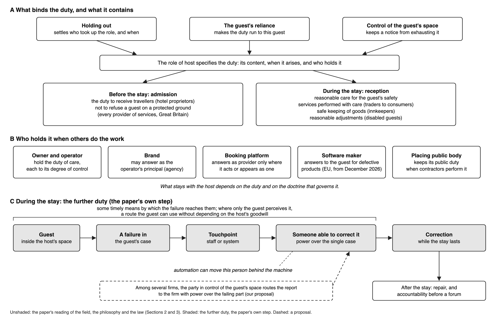

<!--
DRAFTED BY CLAUDE (Opus 5.5), 11 Nov 2026, run rr-2026-11-k. DRAFT v7. Every sentence is Claude's, written to the sentence-by-sentence method against Bulley (2015) as model, from the argument dossier keystone_2026-11/ARGUMENT.md (draft 2) and the claim register keystone_2026-11/claims/. Each sentence and its verdicts: keystone_2026-11/sbs/LEDGER.md (S-001 to S-263, A-1 to A-6). What changed from v6 and why: keystone_2026-11/IMPLICATIONS_FOR_V6.md. DRAFT_v6.md is untouched.
The title is v6's, kept until the authors decide (OUTLINE_PARAGRAPHS.md). The journal's AI policy permits AI only to enhance readability and language; the submitted text and the AI acknowledgment are the authors' decision.
Delete this comment before submission.
-->

# Who hosts the guest? Algorithmic mediation, standing and responsibility in phygital hospitality

## Abstract

Hosts now hand parts of the work of hosting, from pricing to check-in, to algorithmic systems, which can be assembled from services that several firms supply. The hospitality texts we read in full describe what a host owes and name hosting divided among several parties, but none says which party owes the guest what. We argue that the role of host specifies the duty, care for the guest's safety and in what the host undertook, and that holding out, reliance and control bind it to a particular party. When others do the work, what stays with the host depends on the duty, and several parties may hold the duty of care at once. During the stay, we argue, the guest's claim justifies a further duty to keep some timely means by which a failure in the guest's case reaches someone able to correct it, a person algorithmic mediation can move out of the guest's path. The article offers six questions for examining a touchpoint, states what the law already requires, and sets out what hosts can do.

**Keywords:** phygital hospitality; algorithmic mediation; host duties; assembled host; service failure; accountability

## Introduction

Hosts now hand parts of the work of hosting to algorithmic systems, by which we mean software that takes or shapes a decision about a guest. In nine family-run hotels, a revenue-management system recommended the price of each room, and each hotel's manager kept the final decision on whether to follow the recommendation (Garcia et al. 2026). At two automated hotels in China, guests checked in at a kiosk that read an identity card and a face, and a service worker stepped in when the kiosk could not process a guest (Xu and Greiffenhagen 2024: 5020, 5035). In short-term rentals, self-check-in replaces the handover of keys (Bosma 2022: 605). Such systems are often assembled from services that several firms supply, as Cobbe et al. (2023: 1187) show for algorithmic systems at large. We call the guest, the staff, the property, the firms and the systems together a phygital arrangement, and any moment at which the guest meets that arrangement a touchpoint. At a touchpoint, the person who can change what happens to a guest can stand some distance from the guest, behind a system or in another firm.

O'Gorman's history of ancient hospitality records the host's duties to receive the guest, to protect him and, if need be, to represent him in court (2005: 144–145). For the commercial setting, Morrison and O'Gorman list among the principles of hospitality that businesses are responsible for the health, safety and security of their guests (2008: Figure 2). This journal has gone further and named the host's power: its founding editorial treats hospitality as a form of social control, and Bulley (2015) follows that power past the threshold, into the management of guests already inside. The journal also names hosting divided among several parties: micro-hosts and macro-hosts (Lynch et al. 2011), an assembled host (Bulley 2015), and a web of hosts paid for by the Home Office (Petie et al. 2025). In the seven texts we read whole for this question, six of them in this journal, none says which of several hosts owes the guest the host's duty, or gives the guest a route to correction during the stay. Two recent articles place hospitality's ethics at the level of the organization and of socio-technical design (Dogru et al. 2025; Koo and Kwon 2026), and writers on phygital service call for human-first design (Batat 2026) and for contestable design (Shabnam et al. 2026). Research on algorithmic accountability asks who answers when a delegated system causes harm (Kong 2026: 5); we ask what a host owes before anything goes wrong, and who keeps that duty when others do the work.

This article seeks to say what a commercial host owes a guest, on what ground and held by whom, and what that duty asks of a host that performs through other firms and through systems. We argue, first, that the role of host specifies the duty, and that holding out, the guest's reliance and the host's control of the guest's space bind it to a particular party. Second, when others do the work, what stays with the host depends on the duty and on the doctrine that governs it, and several parties may hold the duty of care at once. Third, and here the argument is ours, during the stay the guest's claim justifies a further duty: to keep some timely means by which a failure in the guest's case reaches someone able to correct it. We therefore argue that algorithmic mediation leaves the host's duties in place but can move the person able to correct a failure out of the guest's path, and that the host owes the guest a route to that person.

The next section sets out the host's power and duty as hospitality studies describes them, and says why the duty binds and what the law makes of it. The third section follows the duty when the host hands the work to others, and states the further duty during the stay. The fourth examines touchpoints in hotels, rentals and accommodation for placed guests, from published studies and judgments, and sets out six questions for examining one, the law's floor, and what hosts can do. We set aside whether a machine can itself owe a guest anything, since a robot can occupy a role without being a moral agent (Kropf et al. 2026: 7), and we leave aside guests who cannot report and hosts letting rooms in their own homes. For the study of phygital hospitality the question is who answers to the guest; for a host, the question is whether a guest whose stay goes wrong can reach someone able to put it right.

## The host's power and the host's duty

The host's duty is hard to see in commercial hospitality, in part because the trade has come to describe its own work as service. When Golubovskaya et al. asked twenty-two hotel frontline employees about their work, only six could define hospitality, and 'service' rather than 'hospitality' was their default perspective (2017: 1296). Hospitality scholars, in contrast, have long held that the host owes the guest something beyond the exchange. O'Gorman's study of commercial hospitality in Rome records the host's duties to protect the guest and, if need be, to represent him in court only for private hospitality, and names no such duty of an innkeeper (2007a: 45). Morrison and O'Gorman carry the duty into business, though by prescription: they derived their principles of commercial hospitality from the Rule of St Benedict and the monastic practice of its time (2008). Telfer, as Hemmington reports her, holds that the guest's safety was traditionally the host's most important responsibility (Hemmington 2007). Hemmington adds that the trade often overlooks that responsibility (2007), so for the commercial host, on our reading, the duty is prescribed by the field's scholars rather than observed in its practice. To host, on these accounts, is to take responsibility for the guest's safety while the guest is under one's roof.

In the classical law of hospitality the host commands: 'It is always the host who ordains, the guest who complies' (Pitt-Rivers 2012: 513). Command brings duty with it: a host infringes the same law by failing 'to protect his guest' (Pitt-Rivers 2012: 516). The host's command has a place as well as a holder: 'A host is host only on the territory over which on a particular occasion he claims authority' (Pitt-Rivers 2012: 514). Bulley holds that this power does not end at the threshold: once the guest is inside, the host goes on policing and managing the distinctions that hospitality draws (2015). Moysidou and Stanley go further, and treat the host's power over the space, and to a degree over the guest, as a condition of offering hospitality at all (2023). We read these accounts together as saying that the party who admits the guest takes on the guest's safety, and keeps power over the guest, for as long as the stay lasts.

Yet the field is divided over whether a host who charges can be hospitable at all. Lashley defines hospitableness as 'the willingness to be hospitable for its own sake, without any expectation of recompense or reciprocity' (2015: 1). Commercial hospitality, Lashley observes, is offered at a price and 'would be withdrawn if the payment could not be made', which is why some hold that it 'cannot deliver true hospitableness' (2015: 5). Slattery goes further: 'The buyers are not guests, they are customers. The relationship is not philanthropic it is economic' (2002: 21). Telfer, as Slattery quotes her, calls the paid provider a host too and makes 'hospitable' depend on motive and price: a commercial host who acts 'out of genuine concern for their happiness' and 'charges them reasonably, rather than extortionately', can be called hospitable (Telfer 2000: 45, as quoted in Slattery 2002: 21). As O'Gorman quotes her, Telfer also counts a 'sense of duty where there is also concern for the guests themselves' among hospitable motives (Telfer 1996: 82, as quoted in O'Gorman 2007b). The opposition between duty and hospitableness comes from Blain and Lashley, for whom religious strictures were an obligation that 'may be at odds with Telfer's notion of hospitableness' because it was 'externally imposed' (2014: 2). We keep hospitableness for the manner and motive with which a host's role is performed, and argue that the duty attaches to the role itself, so that it can bind a host whose motive is profit and a host that is a firm. In this sense we disagree with Slattery (2002: 21), for whom it is 'inaccurate and misleading' to treat the host–guest relationship as the critical one in the hospitality business: the corporate context changes who holds the role, not whether it exists.

Derrida, as O'Gorman quotes him, places 'those rights and duties that are always conditioned and conditional' in the plural laws of hospitality (Derrida 2000: 77, as quoted in O'Gorman 2007b). The same page, as Westmoreland quotes it, says it is as though those laws, in 'marking limits, power, rights, and duties', consisted in 'challenging and transgressing' the law that would offer the new arrival an unconditional welcome (Derrida 2000: 77, as quoted in Westmoreland 2008: 8). The host's duty we describe belongs to these conditional laws, which mark the host's power and set limits on the welcome, and we do not claim the unconditional law for it. A role, on our account, specifies the content of a duty, the moment it arises and the party who holds it; whether the role also makes the duty bind is disputed, since what a role is said to require may record 'merely others' expectations' (Jeske 2021: §4). Critics of associative obligation hold that such duties rest on a moral principle outside the role, and associative theorists reply that the critics mistake conditions that disable an obligation for conditions that ground it (Dagger and Lefkowitz 2021: §4.3). We argue that, for the commercial host, three grounds outside the role make the duty bind, each doing different work: holding out settles who took the role up and when; reliance makes the duty run to this guest; control of the guest's space keeps a notice from exhausting it.

Holding out, by which we mean presenting a house to travellers as open to receive them, is how a party takes up the role. Blackstone states the rule for the innkeeper: one who 'hangs out a sign and opens his house for travellers' makes 'an implied engagement to entertain all persons who travel that way' (1768: 164). He counts it among the undertakings that the law implies although they were 'never perhaps actually made' (1768: 161–163). The Hotel Proprietors Act 1956 keeps the trigger: its hotel is an establishment 'held out by the proprietor' as offering food, drink and sleeping accommodation to travellers, and its duties attach 'to the proprietor ... and shall not attach to any other person' (s. 1(1), (3)). A modern English court reads the same structure into negligence: the hotel 'invited guests to come and stay at the hotel and thereby assumed a duty to take reasonable care to protect guests' (Al-Najar 2019: para 187). Holding out takes up the role, and the law supplies the duty.

Reliance explains why the duty runs to this guest: a nightclub's guest, the Court of Appeal held, 'relies on the competence and prudence of its management' and 'is entitled to expect that there will be no violence' (Everett 2011: para 31). The same court grounded the duty in control as well: 'The management is in control of the premises. It can regulate who enters'. In occupiers' law, control is the foundation: 'The foundation of occupier's liability is occupational control' (Wheat v E Lacon 1966, Lord Pearson). No one of the three grounds suffices alone: an undertaking binds a host only to what it undertook, reliance binds only towards those who relied, and dependence, on its own, falls on whoever can help (Jeske 2021: §§3–4; Habib 2022: §§3.3, 5.1). On our account, control joined to reliance carries the duty of care for the guest's person whatever the host undertook, which explains why the law can forbid a host to exclude liability for negligently causing death or personal injury (Consumer Rights Act 2015, s. 65). The history fits this account: commercial lodging served travellers too poor or too little known to have personal hospitality to call on (O'Gorman 2007a), and Roman inns had a reputation for violence and danger (O'Gorman 2005: 146). The praetor's edict made innkeepers answer for the goods they received, and Pomponius, as Ulpian reports him, suggested that the praetor meant to show his care 'reprimendae improbitatis hoc genus hominum', to curb the dishonesty of such men (Digest 4.9.3.1; our translation). Commercial hospitality is therefore where hospitality's protections lapsed and law stepped in, and the law's reasons for the duty sit beside the moral grounds we give without proving them.

In the jurisdictions we draw on, the law sets the host's duties in two tiers: duties of admission, before the stay, and duties of reception, during it. A traveller wrongly refused by an inn could sue the innkeeper: 'His right, I think, is founded on the common law. That right I found was violated' (Constantine 1944: 708). The general duty to receive now attaches to the proprietor of a hotel (Hotel Proprietors Act 1956, s. 1(1)), towards travellers able and willing to pay and fit to be received (s. 1(3)), and it stops at the inn: a bar 'entirely separate' from the hotel was 'a mere shop' (Rymer 1877: 139). Every provider of a service to the public in Great Britain owes a narrower duty of admission: it 'must not discriminate against a person requiring the service by not providing the person with the service' (Equality Act 2010, s. 29(1)). Once a guest is received, the host owes reasonable care for the guest's person: an English hotel owed it against the crimes of third parties, though its guests lost on breach (Al-Najar 2019: paras 187, 240), and Colorado holds a hotel to it in ending a stay (Groh 2015: ¶ 4). A trader who supplies a service to a consumer must perform the service 'with reasonable care and skill', and a consumer whose service falls short may require the trader to perform it again (Consumer Rights Act 2015, ss. 49, 55). The innkeeper also answers, without fault and up to a cap, for the goods of a guest with a bed engaged (Hotel Proprietors Act 1956, s. 2), as the innkeeper has since Calye's Case confined strict liability to the guest's goods 'and not his person' (1584: fol. 33b). A service-provider must also make reasonable adjustments for disabled guests, including an auxiliary aid or service and information in an accessible format (Equality Act 2010, s. 20(3)–(6)). What remains distinctive of hospitality among these duties is narrower: what the innkeeper received was the stranger's person and belongings, overnight, in a house that was not the stranger's own (Sandoval-Strausz 2005: 62–63).

Attention is in part a legal duty in some United States jurisdictions: an innkeeper must give first aid once it 'knows or has reason to know' that a guest is ill or injured, under Restatement (Second) of Torts § 314A as the Colorado court quotes it (Groh 2015: ¶ 29), a section since replaced by Restatement (Third) § 40 (n. 4). In a package holiday, the Supreme Court said, 'the service of looking after and serving holidaymakers courteously in matters relating to their holiday experience' is inherent in every such contract (X v Kuoni Travel 2021: para 30). Beyond first aid and the services sold, attending to the guest's needs and wishes remains, on our reading, a duty of the customary code and not of the law (Pitt-Rivers 2012: 516). In Pitt-Rivers' classical rule the guest 'has no right other than to respect and no obligation other than to honour his host' (2012: 514), and a guest who 'makes claims or demands' usurps the host's place (2012: 515). In commercial hospitality the guest's duties narrow: following King (1995), Golubovskaya et al. write that commercial hospitality often empowers the guest, 'whose only obligation is to pay and behave reasonably' (2017: 1286). The legal duties are owed to the guest, who may sue on them as Constantine did, and in Kansas the innkeeper's relation to the guest creates 'a common law relational duty ... the breach of which is redressible in tort' (Thomas v Pick Hotels 1955: 665–666). The duty to receive was also public: refusing a traveller was indictable (Rymer 1877: 136, 139), and in Ireland it is an offence today, 'without prejudice to his civil liability' (Hotel Proprietors Act 1963, s. 12). On the standard account of rights, a duty owed to someone is that person's claim (Wenar and Cruft 2025: §2.1.2); theories divide on whether holding a claim includes standing to demand it (§2.2.2), and our argument does not depend on that dispute.

The holder of these duties need not be a person: the 1956 Act gives them to 'the proprietor', and the Irish Act defines the proprietor as 'the person carrying on the business of the hotel' (1963, s. 1(1)). Slattery observes that chains of hospitality businesses have replaced unaffiliated venues as the industry's key operators, and that the chains outsource services to suppliers, investors, consultants and internet companies (2002: 24–25). The classical picture, however, is of one host who holds the house, its rule and the guest's safety together (Pitt-Rivers 2012: 513–514). The next question is what becomes of these duties when their holder hands the work of hosting to others.

## Delegation and the guest's claim: Beyond the host in person?

The field has been right about what a host owes, and we have argued that the role of host specifies that duty while holding out, reliance and control make it bind. A second respect in which the field's account must be carried further is its picture of the host as one person. This journal has words for hosting by several parties at once: its founding editorial, after Robinson and Lynch (2007), describes micro-hosts and macro-hosts (Lynch et al. 2011). Bulley describes agencies in a refugee camp performing the role of an assembled host while being guests themselves in a space to which they do not formally belong (2015). Petie et al. find asylum seekers in hotels to have been guests of the hotel, its staff, housing contractors and the local community at once, with the Home Office paying (2025). These accounts describe hosting divided among several parties, and none of them says which party owes the guest the host's duty. Who holds the duty when the work is spread among them is first a question for the law of delegation.

What stays with a host that performs through others depends on the duty, and on the doctrine of law that governs it. English law starts from the rule that the employer of an independent contractor is not, in general, liable for the contractor's wrongs (Barclays Bank v Various Claimants 2020: paras 7, 24, 27). An occupier escapes answering for a contractor's faulty construction, maintenance or repair if it chose the contractor reasonably and took 'such steps (if any) as he reasonably ought' to satisfy itself of the contractor's competence and the work (Occupiers' Liability Act 1957, s. 2(4)(b)). Lord Keith held that an occupier is not ordinarily expected to supervise a contractor it reasonably thinks competent (Ferguson v Welsh 1987: 7); his remark that suspecting an unsafe system might call for steps was guarded, and Lord Goff did not accept it (11). Two hospitality defendants escaped on that footing: a nightclub whose door staff came from a security contractor, and a leisure centre whose machines a contractor maintained, neither having reason to doubt its contractor (Naylor v Payling 2004: paras 19, 50; Maguire v Sefton 2006: para 30). A party that 'undertook to provide and not merely to arrange' services answers for them even where others render them (Wong Mee Wan v Kwan Kin Travel 1995: 10). Package law makes the organiser answer for the travel services whoever performs them (Directive (EU) 2015/2302, art. 13(1)), and the Supreme Court held a tour operator liable to a guest for a hotel employee's assault without resort to vicarious liability (X v Kuoni Travel 2021: paras 45–50). A duty that cannot be discharged by choosing a careful contractor is, in the Supreme Court's word, 'exceptional' (Armes v Nottinghamshire 2017: para 32), and no case we read applies such a duty to an adult hotel guest in England. The claim that the work of hosting can be delegated while the duty cannot is therefore true of some duties and not of others.

Several parties may hold the duty of care at once: of a brewery-owned public house whose manager's wife took in paying summer guests, Lord Denning said that 'two or more may be "occupiers"', each owing care 'dependent on his degree of control' (Wheat v E Lacon 1966). In Crinkley, under North Carolina law, a jury found a motel's owners and manager liable to guests and its franchisor vicariously liable through apparent agency, for which the franchisor's 'significant degree of control over the operation' counted (1988: paras 9, 51). A brand may be the operator's principal where it has 'the right to exercise control over the daily operations' (Billops 1978: 198, Delaware), and in Florida a jury could find that a brand which ran a motel's restaurant and lounge had told the public it would find 'a certain level of service' there (Orlando 1983: 494). Brands have also escaped: where the licence required the operator to disclose itself and the guest had not chosen the motel (Hayman v Ramada Inn 1987: 279), and where only logos and products showed the brand (Mobil Oil v Bransford 1995: 120–121). A booking platform is not the provider of a stay where the host sets the price and the platform does not select hosts (Airbnb Ireland 2019: paras 56–57, 68), but loses its shield from consumer-law liability where consumers would take it for the provider (DSA, art. 6(3)). The manufacturer of defective software that injures a guest will answer to the guest directly in the European Union, for products placed on the market after 9 December 2026, but not for a failure of performance that causes no listed damage (Directive (EU) 2024/2853, arts 2(1), 4(1), 5(1), 6(1), 8(1)(a)). For a guest placed by the state, the placing minister's duty is a public one that 'remains hers' when contractors perform it (R (DMA) 2020: para 100), and, in Lord Scott's words about a privately owned care home, its duties to residents are 'governed by private law' (YL 2007: para 29). On these authorities control of the guest's space carries the duty of care, and several parties may share it; which party answers for the rest of what a guest is owed, among brand, platform and vendor, is a matter we can only propose.

Moral philosophy reaches a similar division: Brandt argues that one who delegates a responsibility remains bound to see that it is fulfilled (2017). His reason fits the host who undertook a stay: an arrangement with a third party cannot alter what was agreed with the party owed (2017). Others hold that a careful hand-over discharges the duty: O'Neill, as Brandt quotes her, has parents who arrange for their children's care 'transfer' rather than breach their obligations (Brandt 2017). Brandt's own delegator, moreover, steps in once it becomes clear that the delegate is failing, and he leaves a means of finding out as one policy option among several (2017). Outside package travel, neither the law of delegation nor this literature says that a host must keep a means of learning of a failure in the guest's case while it can still be put right.

But what becomes of the host's duty during the stay, once the host performs through other firms and through systems? For the length of the stay the guest is inside the host's space, on the territory over which the host claims authority, and subject to the host's ordering of it. Leaving has a cost: an au pair told Moysidou and Stanley that she had not complained because she could not leave (2023), and asylum seekers in hotels are housed on a no-choice basis (Petie et al. 2025). Once inside, Bulley observes, neither host nor guest can assert sovereignty without ending the relation and casting the other out (2015). Moysidou and Stanley treat a guest's effective complaint as a form of power, since knowing how to complain and feeling that a complaint will be acted upon are themselves power (2023), and Bulley's better hospitality keeps the welcome open after the threshold (2015). During the stay, then, whether a failure in the guest's case is put right depends on whether it reaches someone able to put it right, and the guest's standing to complain matters only if it does.

We argue that the guest's claim to performance justifies, during the stay, a further duty of the host; this step is ours, and we state its grounds. In legal theory, Herstein reports, 'the same claim-right seemingly can count in favor of different and changing duties, for instance given changes in factual circumstances' (2023: §8.4), a view he traces to Raz; carrying it to the guest's moral claim is our step. The facts that change here are delegation and automation: once performance runs through others and systems, whether the guest's claim is met depends on the host's learning of a failure while the failure can still be corrected. An 'ought', Kiesewetter argues, transmits to the necessary means of doing what one ought to do (2015: 922). Performance in the guest's case cannot be secured without some timely means of learning of failures and correcting them, so the host owes some such means, though not any particular one. Where only the guest perceives a failure, a route from the guest is itself one of the necessary means. Hotels do learn of guests' failures this way: a Helsinki hotel relied mainly on guests' feedback (Schumacher and Komppula 2016: 121), and at the automated hotels each guest the kiosk could not process went to find a worker (Xu and Greiffenhagen 2024: 5035). Not every guest reports, however: in restaurant experiments, customers who felt low in power complained less (Min and Kim 2020: 2), and a failure of the whole system needs no report at all (Xu and Greiffenhagen 2024: 5021). The evidence is thin, two small studies in hotels, and it suggests that the guest's report is the main route for failures in the guest's own case, not the only one.

Because the guest is subject to the host's power and leaving has a cost, the route must also be one the guest can use without depending on the host's goodwill. We take the further duty to be owed to the guest, since the guest's claim justifies it, though Herstein reports that duties a right justifies as facts change arguably strain the correlation between rights and duties (2023: §8.4). The further duty differs in this from Hindriks's 'duty of control', a second-order duty on an organization to meet the prerequisites of its first-order duties, which he grounds partly in risk to others and does not say is owed to anyone (2025: 4–5). The further duty differs too from service recovery, which studies how a firm's response to complaints shapes complainants' satisfaction and loyalty (Gelbrich and Roschk 2011), since the duty binds where recovering a guest does not pay. A host that keeps no means of correction during the stay therefore wrongs its guests even if nothing fails, and a host whose correctable failure then goes uncorrected also fails in the duty to perform. The further duty runs for the stay, as the guest's subjection does, and within the stay what the route carries is correction, by which we mean late performance or the repair of a lapse. After the stay, the guest's claims run to repair and to accountability, in Fox's sense, after Schedler, of a party's capacity to demand answers and to impose sanctions (Fox 2007: 665). We call the power to depart from what the host's arrangements produced in a guest's case power over the single case.

The law reaches part of this by another road: in United States federal law, a defendant who believes a fact highly probable and deliberately avoids confirming it is treated as knowing it (Global-Tech Appliances v SEB 2011: 769). English law asks for a suspicion 'firmly grounded and targeted on specific facts' and a deliberate decision not to confirm it (Manifest Shipping v Uni-Polaris 2001: para 116). A host whose general awareness that guests need help falls short of such a suspicion stands outside the law's knowledge doctrines, and its case turns on what care requires, which is where we have argued the further duty. Hormio's account of culpable ignorance in organizations supports the step in moral terms: an organization's design alone can make its members ignorant, and once problems are pointed out the organization must try to fix the design (2018). What the further duty asks of a host at a particular touchpoint is the subject of the next section.

## Assembled hosts at the touchpoint

Once the host is an assembled host and the duty of care follows control, the route a guest's report travels through the host's arrangements comes into view (Figure 1). Germann Molz has shown one part of that route: Airbnb's lawyers argued that 'any penalty should be on the hosts renting out their homes, not on the company' (Mock, as quoted in Germann Molz 2018: 244). We follow the route in hotels, short-term rentals and accommodation for placed guests, and take our cases from published studies and judgments rather than construct them.

**Figure 1.** The host's duty, its holders, and the further duty during the stay.

### Where the person with power sits

Power over the single case differs from power over the rule: the first departs from what the arrangements produced for one guest, and the second changes the arrangements themselves. In the family-run hotels that Garcia et al. studied, the manager decided each price, while the model that recommended it was supplied by an independent revenue-management company (2026). The model's advice still shaped prices: when a manager changed a price by hand, a one per cent change in the recommended price moved the realized price by 0.72 per cent on average (Garcia et al. 2026). Power over the rule can therefore lie with a vendor while power over the single case stays at the property, though this study observed managers and not guests. Batat names two processes by which experience moves between settings, 'digitalization' from physical to digital and 'physicalization' from digital to physical (2024: 1230–1231). Her framework is built to make experience move smoothly between the two, and who can correct a failure along the way is a different question.

Where the power to correct sits has always varied with the kind of house and the way its authority is graded. At a small hotel in Helsinki, reception staff could give discounts without asking anyone, were reluctant to go beyond 10–20 per cent of the room rate, and did not know where their authority ended (Schumacher and Komppula 2016: 121–123). Under pandemic rules, a hotel's security employee resolved a guest's problem by checking with management, and a guest refused check-in came back the next day to complain to the general manager and the group's head office (Xiang et al. 2022). On a rental platform, 'host' names several roles, among them primary hosts, listing owners and co-hosts, and one co-host took her instructions from the app rather than from the owner (Bosma 2022: 601). In accommodation for placed guests, hotel staff became hosts almost overnight to people whose needs called for knowledge that commercial hospitality does not usually require (Petie et al. 2025). The route differs by format, then, but the question put to each is the same: can a failure in a guest's case reach someone with power over it?

Automation can move that person without removing them: the automated hotels Xu and Greiffenhagen studied kept service workers on site 'for legal and technical reasons', though guests could register alone (2024: 5035). Guests walked past the worker to the kiosk, and a guest who approached the worker was sent back to the kiosk to 'do it yourself' (5022). Guests whom the kiosk could not process reached the worker by seeking the worker out (5035). The authors' own argument is that such a kiosk disciplines guests, by 'a technology that uses voice commands to tell them what to do with their bodies' (5016). A survey in Macau points the other way on one measure: recalling a robot's failure did not directly raise respondents' intention to switch to a human-staffed service (Lee et al. 2025: 9). On this evidence automation can move the person with power behind the machine and strengthen the host's hold on the guest's conduct, and the open studies do not show that it removes the person.

### Who must be at the end of the route

The end of the route need not always be a person, and the cases show when it must be. Where the arrangements can produce what the guest is owed, retrying cures a failure: at the automated hotels most failures of face recognition were cured by guests trying again, sometimes with advice from bystanders or staff (Xu and Greiffenhagen 2024: 5025, 5027, 5030). Where retrying cannot cure it, correction needs power to depart from the arrangements' output, as when a worker checked in by hand the 13 guests the kiosk could not process (5035). For failures of a documented type, a reachable power to override is a precaution a host can foresee needing, since a failure is foreseeable when its causal mechanism was known in advance (Kong 2026: 6). For a failure of no documented type Kong offers no support, treating it as 'the faultless accident' (2026: 7); there we offer only our reading, that the case the arrangements did not foresee is where a host's conditional laws meet what exceeds them. We therefore ask for a natural person at the end of the route where no configured process covers the type of failure and what is at stake warrants one. From 2 December 2027, European law requires that high-risk AI systems listed in Annex III let the people assigned to oversee them 'disregard, override or reverse the output', as appropriate and proportionate (Regulation (EU) 2024/1689, arts 14(4), 113, as amended by Regulation (EU) 2026/1744), and it leaves systems that only confirm a person's identity off that list (Annex III, point 1(a)).

The person at the end of the route owes the guest care in using that power. In Groh, guests told a hotel's guard that they could not leave because 'We are drunk. We can't drive', and the hotel evicted them; the Colorado court held that the duty of care governed how the stay was ended (Westin Operator v Groh 2015: ¶¶ 4, 7). The holder, for its part, owes the person at the end of the route real authority, which in the Helsinki hotel was unwritten. In the Glasgow hotels, staff told of a guest's deteriorating health the night before an attack lacked the knowledge to act, and an inquiry treated them as victims of management's decisions rather than as individually responsible (Petie et al. 2025). A route to someone without authority is not a route to correction, so on our account the holder must give that person power in writing, the training to use it, and protection from becoming the object of the route.

The holder must also learn across cases: in the Glasgow hotels, the Government's evaluation found that a guest's queries had each been dealt with appropriately but should together have served as a warning sign (Petie et al. 2025). The UN Guiding Principles give a grievance channel the same second function: 'by analysing trends and patterns in complaints, business enterprises can also identify systemic problems and adapt their practices accordingly' (United Nations 2011: 32). Where several firms host together, each answers on these accounts for its own part (Kong 2026: 9), and a loose collection of firms is not itself an agent (Pettit 2007: 195). We propose that the party in control of the guest's space owes the duty to route a guest's report to the firm with power over the failing part, because that party is where the guest is. The one analogue we found is in occupiers' law, where Lord Denning said that if the occupiers on the spot 'had realised the handrail was dangerous, they should have reported it to the Brewery Company' (Wheat v E Lacon 1966).

### Six questions and four cases

From these points we derive a test that researchers can use to analyse a touchpoint and hosts can use to audit one, and the test asks one question: can a failure in a guest's case reach, in time, someone able to correct it? The test puts six questions, in the order a report travels:

1. Who perceives a failure in the guest's case: the guest, the staff or the system?
2. Is the guest told of a route, and can the guest use it without depending on the host's goodwill?
3. Where does the route end, and can whoever is there depart from the arrangements' output in this case?
4. Is that power real: written, supported by training, and protected?
5. Can the report arrive, and the correction be made, while the stay still allows it?
6. Does the holder learn across cases and, among several firms, does one party route the report?

The questions keep apart the power a report reaches and the use made of it, and the single case and the pattern across cases.

Four documented cases show the test at work, from automated check-in to accommodation for people placed by the state. At the automated hotels, guests whose identity or reservation the kiosk could not process found a worker who checked them in by hand, and when the kiosk was down for two days a worker met every arriving guest (Xu and Greiffenhagen 2024: 5021, 5035). On the test, the route existed and ended in a worker able to override the kiosk, but a guest the kiosk could not process found that worker only by seeking the worker out, so the touchpoint passes the third and fifth questions and fails the second. In Groh, the guests' report reached guards with power over the single case, who refused a friend's request to let the group wait in the lobby, an option the court counted among 'relatively low-cost options' (2015: ¶¶ 7–8, 36). The touchpoint passes the third question and fails the fourth, since the power reached was used against the guests, and the duty of care, not the route, governs that failure.

In Rasnick, a guest's wife telephoned a motel repeatedly, and on her account one operator hung up and her later calls met a recorded message; a housekeeper found the guest the next morning unable to get up (Rasnick v Krishna Hospitality 2011: 565, n. 1; dissent at 572). The Georgia court held that the motel owed no legal duty to check on him (569–570), and the case lies outside the further duty, which concerns the host's own performance; it shows a report reaching an operator and going no further. In R (DMA), contractors housing people for the Home Secretary recorded them on a portal as having 'failed to travel', and one case was closed thirteen minutes after a charity e-mailed to ask about it (2020: paras 63, 77, 79). The court declared the minister in breach for failing properly to monitor provision, reasoning that she must be able to act 'at the time and in the individual case' (paras 236–241, 333), in a setting where inhuman or degrading treatment was imminent. The Court of Appeal has since read the case as requiring a system to ensure that contractors performed the minister's duty, not a free-standing duty to monitor under the Equality Act (RR v Enfield 2025: paras 80–81). The cases show that a route can exist and still fail at a different question in each, and that the questions locate where it fails.

### When the route is owed, and the law's floor

Which decisions need the route most depends on when their effects land. Not every touchpoint needs a person standing by at the moment a decision is taken. Baum and Laux sort forms of human oversight by when they act, and find that only oversight acting before a decision takes effect can change that decision (2026b: 120–122). For hospitality we draw the boundary at correction: the route is owed while correction can still help the guest during the stay, and after the stay the guest's claim runs to repair. Three laws put correction before money: remedy during a package trip, repeat performance of a consumer service, and the rectification of a platform's decision about a worker, with compensation 'Where such rectification is not possible' (Directive (EU) 2015/2302, art. 13; Consumer Rights Act 2015, ss. 55, 56(3); Directive (EU) 2024/2831, art. 11(3)). Earlier intervention is the exception: a claim to a hearing before a deprivation 'rests on the proposition that full relief cannot be obtained at a postdeprivation hearing' (Mathews v Eldridge 1976: 331). Table 1 places common hospitality decisions against this boundary.

**Table 1.** Hospitality decisions by whether correction during the stay can still help, and the route each needs.

| Decision | When its effect lands | Can correction during the stay help? | Route the further duty asks for | Source |
|---|---|---|---|---|
| Refusal at arrival | Before reception | Yes, if someone can admit the guest that night | None from the further duty; the duty to receive (innkeepers) and the duty not to refuse on a protected ground (every provider) govern | Hotel Proprietors Act 1956, s. 1; Equality Act 2010, s. 29(1) |
| Identity or booking not recognized at check-in | At arrival | Yes | A worker or process able to override the system, reachable at once | Xu and Greiffenhagen 2024: 5035 |
| Danger on the premises | During the stay | Yes, while the guest is still exposed | A person on the spot with power to act | Our reading |
| A service in the room fails | During the stay | Yes | A route the guest is told of, ending with someone able to put it right that day | Our reading |
| A charge disputed during the stay | At payment | In part | A route during the stay; repair after it | Our reading |

Every placement not attributed to a source is our reading.

The law sets a floor beneath this boundary, reaching part of what the further duty asks by another road. A consumer may require a trader to perform a service again, and a package traveller may set a period for a remedy and send complaints through the retailer (Consumer Rights Act 2015, s. 55; Package Travel Regulations 2018, regs 15(4), 17). EU and UK law count it against a trader that a consumer must take onerous or disproportionate steps to exercise rights under a contract (Directive 2005/29/EC, art. 9(d); Digital Markets, Competition and Consumers Act 2024, s. 228(2)(f)). Public bodies enforce that rule; EU law also gives a harmed consumer remedies, compensation among them (Directive 2005/29/EC, art. 11a), while the UK consumer's own redress under the 2024 Act was not in force in the latest text we read (ss. 231–232). In Great Britain a disabled guest is owed reasonable adjustments, including an auxiliary service and information in an accessible format, so a host whose only route is a kiosk or an app may owe such a guest a reachable person (Equality Act 2010, s. 20(5), (6), (11)). In the EU a solely automated decision with legal or similarly significant effects is in principle prohibited outside three exceptions (SCHUFA 2023: paras 52–53), while in the UK such decisions are now lawful outside special-category data if safeguards let the person obtain human intervention (Data (Use and Access) Act 2025, s. 80). Platforms must keep a point of contact that does not 'solely rely on automated tools' (Digital Services Act, art. 12(1)), and from 2029 package organisers must be 'easily contactable' about failures during a trip (Directive (EU) 2026/1024, art. 16a). Outside package travel, platform moderation and solely automated significant decisions, no law we read gives an accommodation guest a route to a natural person with power over the single case, and UK package law's contact point is a duty owed to the state (Package Travel Regulations 2018, regs 7, 35; Sch. 5, para. 4). Nor, on our reading, does a missing route add a head of liability: a party that undertook a service answers for its improper performance with or without one (X v Kuoni 2021: para 50), and in personal injury the lost chance that a report would have prevented harm is not compensated (Gregg v Scott 2005: para 90). The Georgia court left a duty to check on guests to its legislature (Rasnick 2011: 569), and in law the further duty is a proposal for legislatures and for hosts' own practice.

### Designing for correction during the stay

Some of what a guest needs can be given at the interface, and some only by the institution behind it. The institutional principles follow from the further duty, and the first is a route the guest is told of and can use without a confrontation, in forms a disabled guest can use, since guests who feel low in power complain less (Min and Kim 2020: 2). The second is power at the end of the route, given in writing, with the training to use it. The third is learning across cases, so that single reports that together signal a failure are read together. The fourth, where several firms host together, is that one party, the party in control of the guest's space on our proposal, routes each report to the firm with power over the failing part. A small host meets these principles with a telephone number that the owner answers.

We set these principles out as five stages a host can take in turn, in an order that is ours and is not a ranking by cost (Table 2). The fifth stage is accountability after the stay, in Bovens's sense of a relationship in which an actor must explain and justify its conduct to a forum that 'can pose questions and pass judgement' (2007: 450).

**Table 2.** Five stages from audit to accountability after the stay (the order is ours).

| Stage | What the host does | What it secures for the guest |
|---|---|---|
| 1. Examine | Puts the six questions to each touchpoint | A map of where a failure in a guest's case can and cannot reach someone able to correct it |
| 2. Tell | Tells guests the route, in forms every guest can use | A route the guest knows of and can use without a confrontation |
| 3. Empower | Gives the person at the route's end power in writing, training and protection | Someone able to correct the failure in the guest's case |
| 4. Learn and route | Reads reports across cases; among several firms, one party routes each report | Correction of patterns, and of failures in another firm's part |
| 5. Answer | Answers after the stay before a forum that can question and judge | Accountability for what was not corrected |

## Conclusion

Hospitality studies' account of the host, who protects the guest and holds power over the guest, remains the right place to begin the study of phygital hospitality. That account, however, pictures a single host who holds the duty in person, and the texts we read that name hosting divided among several parties do not say which party owes the guest what. An account of phygital hospitality therefore has to follow the host's duty to its holder or holders across firms and systems, and through the stay, while the guest is subject to arrangements the guest did not make.

In this article we have argued, first, that the role of host specifies what a commercial host owes, care for the guest's safety and care in performing what the host undertook, and that holding out, reliance and control bind that duty to a particular party. Second, when others do the work, what stays with the host depends on the particular duty, and the duty of care may lie with several parties at once, each to its degree of control. Third, and this step is ours, the guest's claim during the stay justifies a further duty, owed to the guest, to keep some timely means by which a failure in the guest's case reaches someone able to correct it. Where only the guest perceives the failure, the means must include a route the guest can use without depending on the host's goodwill. Algorithmic mediation leaves the host's duties in place and can move the person able to correct a failure behind the machine, as it did at the two automated hotels in China. Parts of what the further duty asks are already in soft law: the UN Guiding Principles ask each business for grievance channels open directly to those whose human rights it may adversely affect, so that grievances are remedied early (United Nations 2011: 31–32). For automated systems, the White House Office of Science and Technology Policy asks for 'access to a person who can quickly consider and remedy problems' (2022: 46), and the Treasury Board of Canada Secretariat reserves the final administrative decision to a human where the decision's impacts are high and difficult or impossible to reverse (2025: Appendices B–C). Scholarship comes close as well: Kong (2026: 5) keeps the deployer of an AI agent answerable for foreseeable types of outcome, Baum et al. (2026a: 14–17) require that those an agent affects can challenge its action, and Binesh and Syah (2026: 10) hold that protecting guests' autonomy requires 'real human override at the service encounter'. In the literature we searched, we found no work that derives a guest's route to correction from the duty a host owes the guest, and that derivation is what this article adds, with power over the single case as what the route must reach. Human-centricity, on this account, concerns whether a guest can bring a failure to someone able to correct it, and whether the person at the end of the route holds the power to correct it.

This is a conceptual paper, and its cases, all taken from published studies and judgments, illustrate its distinctions without testing them. In law the further duty is a proposal: the law we read gives guests remedies and disabled guests adjustments, and, outside package travel and platforms, requires no general route to someone able to correct a failure. We read several sources only as others report them, among them three authors the argument leans on: Raz on how one claim can justify changing duties, and Telfer and Derrida on hospitality. The evidence that failures in a guest's case reach the host mainly through the guest comes from two small hotel studies, and for failures of no documented type the need for someone able to correct them is our own reading. The further duty serves guests who can perceive and report a failure, not a guest in crisis or without the host's language, and we do not claim it for hosts letting rooms in their own homes. That duty asks for correction during the stay and leaves disputed complaints to be judged by others, since a business 'cannot, with legitimacy, both be the subject of complaints and unilaterally determine their outcome' (United Nations 2011: 35).

Four studies would test the argument where we found it thinnest, and the first would record how often hotel guests report a failure during the stay, to whom, and by what route. The second would compare recovery after a self-service or robot failure with and without an employee the guest can reach, a comparison no openly available hospitality study we found has made. The third would follow a guest's report through unstaffed hotels and rentals with self-check-in, recording who received the report, what that person could change, and how long correction took. The fourth is for legal scholarship: whether the Irish Act's safety duty makes a proprietor answer for contractors, and whether courts would count the lack of any route as a want of care.

A host can act on the argument now, by putting the six questions to each touchpoint and telling guests, in forms every guest can use, whom to reach and how. The person a guest reaches needs power in writing, the training to use it and protection from being disciplined through guests' reports, since a route that ends in someone without power leaves the failure with the guest. For the guest's well-being, what matters is who bears a failure: without a route the guest bears it alone, and turning away from a service reached only through an app 'may carry a personal cost and loss' (Wilson-Nash et al. 2026: 979). For staff, algorithmic management brings gains and costs: experts expect it to raise efficiency in hotels and to intensify work (Jianu et al. 2025: 1, 6), and many room attendants who found an algorithm's one-room-at-a-time setting stressful were able, working with management, to phase it out (Spektor et al. 2023: 629). The question for phygital hospitality is whether, in arrangements that spread a host's work across staff, firms and systems, a failure in a guest's case can still reach someone able to correct it, and for particular arrangements the answer is not yet known.

## Acknowledgment of the Use of Generative AI and AI-Assisted Technologies in the Writing Process

Throughout the preparation of this work, the authors employed Claude (Anthropic; Fable 5.2 and Opus 5.5) to search for and read sources, check citations and quotations, and draft the revised article and the responses to reviewers. Following the utilization of this tool/service, the authors thoroughly reviewed and edited the content as necessary, assuming full responsibility for the publication's content.

## References

Batat, Wided (2024), 'What does phygital really mean? A conceptual introduction to the phygital customer experience (PH-CX) framework', *Journal of Strategic Marketing*, 32:8, pp. 1220–1243.

Batat, Wided (2026), 'Phygital service research (PSR): Advancing FSR and TSR toward human-first experience design in hybrid physical-digital ecosystems', *Journal of Services Marketing*, 40:4, pp. 505–518.

Baum, Kevin and Laux, Johann (2026b), 'Constitutive vs. corrective: A causal taxonomy of human runtime involvement in AI systems', in *Bridging the Gap Between AI and Reality*, Cham: Springer Nature Switzerland, pp. 115–130.

Baum, Kevin, Kiener, Maximilian, Langer, Markus and Laux, Johann (2026a), *Anticipatory human oversight of agentic AI: A philosophical account*, https://doi.org/10.2139/ssrn.7497218.

Binesh, Nasim and Syah, Ahmad (2026), 'AI ethics in hospitality and tourism: Theoretical perspectives, ethical beliefs, and actionable outcomes', *Frontiers in Artificial Intelligence*, 9, 1913343.

Blackstone, William (1768), *Commentaries on the laws of England*, Oxford: Clarendon Press.

Blain, Matthew and Lashley, Conrad (2014), 'Hospitableness: The new service metaphor? Developing an instrument for measuring hosting', *Research in Hospitality Management*, 4:1–2, pp. 1–8.

Bosma, Jelke R. (2022), 'Platformed professionalization: Labor, assets, and earning a livelihood through Airbnb', *Environment and Planning A: Economy and Space*, 54:4, pp. 595–610.

Bovens, Mark (2007), 'Analysing and assessing accountability: A conceptual framework', *European Law Journal*, 13:4, pp. 447–468.

Brandt, Reuven (2017), 'The transfer and delegation of responsibilities for genetic offspring in gamete provision', *Journal of Applied Philosophy*, 34:5, pp. 665–678.

Bulley, Dan (2015), 'Ethics, power and space: International hospitality beyond Derrida', *Hospitality & Society*, 5:2–3, pp. 185–201.

Cobbe, Jennifer, Veale, Michael and Singh, Jatinder (2023), 'Understanding accountability in algorithmic supply chains', *Proceedings of the 2023 ACM Conference on Fairness, Accountability, and Transparency (FAccT '23)*, pp. 1186–1197.

Dagger, Richard and Lefkowitz, David (2021), 'Political obligation', in Zalta, Edward N. (ed.), *The Stanford Encyclopedia of Philosophy*, Metaphysics Research Lab, Stanford University.

Derrida, Jacques and Dufourmantelle, Anne (2000), *Of hospitality*, Stanford, CA: Stanford University Press.

Dogru, Tarik, Hanks, Lydia, Line, Nathan Discepoli, Mody, Makarand Amrish and Suess, Courtney (2025), 'From service to virtue: How organizations harness hospitality for transformative social change', *International Journal of Contemporary Hospitality Management*, 37:12, pp. 4101–4121.

Fox, Jonathan (2007), 'The uncertain relationship between transparency and accountability', *Development in Practice*, 17:4–5, pp. 663–671.

Garcia, Daniel, Tolvanen, Juha and Wagner, Alexander K. (2026), 'Strategic responses to algorithmic recommendations: Evidence from hotel pricing', *Management Science*, 72:1, pp. 609–626.

Gelbrich, Katja and Roschk, Holger (2011), 'A meta-analysis of organizational complaint handling and customer responses', *Journal of Service Research*, 14:1, pp. 24–43.

Germann Molz, Jennie (2018), 'Discourses of scale in network hospitality: From the Airbnb home to the global imaginary of "belong anywhere"', *Hospitality & Society*, 8:3, pp. 229–251.

Golubovskaya, Maria, Robinson, Richard N.S. and Solnet, David (2017), 'The meaning of hospitality: do employees understand?', *International Journal of Contemporary Hospitality Management*, 29:5, pp. 1282–1304.

Habib, Allen (2022), 'Promises', in Zalta, Edward N. and Nodelman, Uri (eds), *The Stanford Encyclopedia of Philosophy*, Metaphysics Research Lab, Stanford University.

Hemmington, Nigel (2007), 'From service to experience: Understanding and defining the hospitality business', *The Service Industries Journal*, 27:6, pp. 747–755.

Herstein, Ori (2023), 'Legal rights', in Zalta, Edward N. and Nodelman, Uri (eds), *The Stanford Encyclopedia of Philosophy*, Metaphysics Research Lab, Stanford University.

Hindriks, Frank A. (2025), 'The moral failures of collective agents: responsibility voids and control gaps', *Synthese*, 205:4.

Hormio, Säde (2018), *Culpable ignorance in a collective setting*, https://doi.org/10.31235/osf.io/85nbu.

Jeske, Diane (2021), 'Special obligations', in Zalta, Edward N. (ed.), *The Stanford Encyclopedia of Philosophy*, Metaphysics Research Lab, Stanford University.

Jianu, Brana, Ashton, Mark and Lugosi, Peter (2025), 'Integrating algorithmic management in hotels: Emerging challenges and opportunities for frontline managers', *International Journal of Hospitality Management*, 129, 104168.

Kiesewetter, Benjamin (2015), 'Instrumental normativity: In defense of the transmission principle', *Ethics*, 125:4, pp. 921–946.

King, Carol A. (1995), 'What is hospitality?', *International Journal of Hospitality Management*, 14:3–4, pp. 219–234.

Kong, Kennedy Chun Yin (2026), 'The delegation illusion: why deploying autonomous AI agents does not diminish principal responsibility', *AI and Ethics*, 6:5, 518.

Koo, Chulmo and Kwon, Jookyung (2026), 'Three ages of hospitality reflection: Origins, contemporary, and future', *International Journal of Contemporary Hospitality Management*, 38:8, pp. 2471–2486.

Kropf, Mario, Spöck, Christoph and Werner, Roman (2026), 'Blame the robot: Role responsibility and ethical issues regarding AI-based care robots', *International Journal of Social Robotics*, 18:2, 30.

Lashley, Conrad (2015), 'Hospitality and hospitableness', *Research in Hospitality Management*, 5:1, pp. 1–7.

Lee, Wing Han Helen, Chan, Suk Ha Grace, Tang, Binglin Martin and Song, Zhiwen (2025), 'Robot or human? Manoeuvring switching intention after robot service failure', *PLOS One*, 20:11, e0333616.

Lynch, Paul, Germann Molz, Jennie, McIntosh, Alison, Lugosi, Peter and Lashley, Conrad (2011), 'Theorizing hospitality', *Hospitality & Society*, 1:1, pp. 3–24.

Min, Hyounae (Kelly) and Kim, Hyun Jeong (2020), 'Do all angry customers complain?', *ICHRIE Research Reports*, 5:1.

Morrison, Alison and O'Gorman, Kevin (2008), 'Hospitality studies and hospitality management: A symbiotic relationship', *International Journal of Hospitality Management*, 27:2, pp. 214–221.

Moysidou, Gesthimani and Stanley, Phiona (2023), 'Theorizing gender in homestay settings: Mobilities and/as power relations', *Hospitality & Society*, 13:3, pp. 241–263.

O'Gorman, Kevin D. (2005), 'Modern hospitality: Lessons from the past', *Journal of Hospitality and Tourism Management*, 12:2, pp. 141–151.

O'Gorman, Kevin D. (2007a), 'Discovering commercial hospitality in ancient Rome', *Hospitality Review*, 9:2, pp. 44–52.

O'Gorman, Kevin D. (2007b), 'The hospitality phenomenon: Philosophical enlightenment?', *International Journal of Culture, Tourism and Hospitality Research*, 1:3, pp. 189–202.

Petie, Olivia, Phillimore, Jenny and Allsopp, Jennifer (2025), 'Exploring hospitality, hostility and (un)home in hotel accommodation for asylum seekers in the United Kingdom', *Hospitality & Society*, 15:1, pp. 23–44.

Pettit, Philip (2007), 'Responsibility incorporated', *Ethics*, 117:2, pp. 171–201.

Pitt-Rivers, Julian (2012), 'The law of hospitality', *HAU: Journal of Ethnographic Theory*, 2:1, pp. 501–517.

Robinson, Martha and Lynch, Paul (2007), 'The power of hospitality: A sociolinguistic analysis', in Lashley, Conrad, Lynch, Paul and Morrison, Alison (eds), *Hospitality: A Social Lens*, Oxford: Elsevier, pp. 141–154.

Sandoval-Strausz, A. K. (2005), 'Travelers, strangers, and Jim Crow: Law, public accommodations, and civil rights in America', *Law and History Review*, 23:1, pp. 53–94.

Schumacher, Satu and Komppula, Raija (2016), 'A case study on service recovery: Frontline employees' perspectives and the role of empowerment', *European Journal of Tourism, Hospitality and Recreation*, 7:2, pp. 117–127.

Shabnam, Saadia, Roy, Sanjit Kumar, Roten, Yonathan Silvain, Singh, Gaganpreet, Suh, Taewon and Li, Hairong (2026), 'Transformative phygital service research (TPSR): An agenda for future research', *Journal of Services Marketing*, pp. 1–17.

Slattery, Paul (2002), 'Finding the hospitality industry', *The Journal of Hospitality Leisure Sport and Tourism*, 1:1, pp. 19–28.

Spektor, Franchesca, Fox, Sarah E., Awumey, Ezra, Riordan, Christine A., Rho, Hye Jin, Kulkarni, Chinmay, Martinez-Lopez, Marlen, Stringam, Betsy, Begleiter, Ben and Forlizzi, Jodi (2023), 'Designing for wellbeing: Worker-generated ideas on adapting algorithmic management in the hospitality industry', *Proceedings of the 2023 ACM Designing Interactive Systems Conference (DIS '23)*, pp. 623–637.

Treasury Board of Canada Secretariat (2025), *Directive on automated decision-making*, https://www.tbs-sct.canada.ca/pol/doc-eng.aspx?id=32592.

United Nations, Office of the High Commissioner for Human Rights (2011), *Guiding principles on business and human rights: Implementing the United Nations "protect, respect and remedy" framework*, https://www.ohchr.org/sites/default/files/documents/publications/guidingprinciplesbusinesshr_en.pdf.

Wenar, Leif and Cruft, Rowan (2025), 'Rights', in Zalta, Edward N. and Nodelman, Uri (eds), *The Stanford Encyclopedia of Philosophy*, Metaphysics Research Lab, Stanford University.

Westmoreland, Mark W. (2008), 'Interruptions: Derrida and hospitality', *Kritike: An Online Journal of Philosophy*, 2:1, pp. 1–10.

White House Office of Science and Technology Policy (2022), *Blueprint for an AI bill of rights: Making automated systems work for the American people*, The White House, https://bidenwhitehouse.archives.gov/wp-content/uploads/2022/10/Blueprint-for-an-AI-Bill-of-Rights.pdf.

Wilson-Nash, Carolyn, Angell, Rob, Qiu, Yuanming, Pavlopoulou, Ismini and Kolyperas, Dimitrios (2026), 'No app, no entry: Conceptualizing digital technology captivity in service access', *Psychology & Marketing*, 43:5, pp. 974–985.

Xiang, Keheng, Huang, Wei-Jue, Gao, Fan and Lai, Qin (2022), 'COVID-19 prevention in hotels: Ritualized host-guest interactions', *Annals of Tourism Research*, 93, 103376.

Xu, Xinzhi and Greiffenhagen, Christian (2024), 'The disciplined customer: A video-based study of automated self-service hotels', *New Media & Society*, 26:9, pp. 5013–5038.

### Cases

Airbnb Ireland (2019), Case C-390/18, criminal proceedings against X (Airbnb Ireland), judgment of the Court (Grand Chamber) of 19 December 2019.

Al-Najar v The Cumberland Hotel (London) Ltd [2019] EWHC 1593 (QB).

Armes v Nottinghamshire County Council [2017] UKSC 60.

Barclays Bank plc v Various Claimants [2020] UKSC 13.

Billops v Magness Construction Co (1978) 391 A.2d 196 (Del.).

Calye's Case (1584) 8 Co Rep 32a, 77 ER 520.

Constantine v Imperial Hotels Ltd [1944] 1 KB 693.

Crinkley v Holiday Inns, Inc (1988) 844 F.2d 156 (4th Cir.).

Everett v Comojo (UK) Ltd [2011] EWCA Civ 13, [2012] 1 WLR 150.

Ferguson v Welsh [1987] UKHL 14, [1987] 1 WLR 1553.

Global-Tech Appliances, Inc v SEB SA (2011) 563 U.S. 754.

Gregg v Scott [2005] UKHL 2.

Hayman v Ramada Inn, Inc (1987) 86 N.C. App. 274.

Maguire v Sefton Metropolitan Borough Council [2006] EWCA Civ 316.

Manifest Shipping Co Ltd v Uni-Polaris Shipping Co Ltd (The Star Sea) [2001] UKHL 1, [2003] 1 AC 469.

Mathews v Eldridge (1976) 424 U.S. 319.

Mobil Oil Corp v Bransford (1995) 648 So. 2d 119 (Fla.).

Naylor (t/a Mainstreet) v Payling [2004] EWCA Civ 560.

Orlando Executive Park, Inc v Robbins (1983) 433 So. 2d 491 (Fla.).

R (DMA) v Secretary of State for the Home Department [2020] EWHC 3416 (Admin).

R (RR) v London Borough of Enfield [2025] EWCA Civ 1390.

R v Rymer (1877) 2 QBD 136.

Rasnick v Krishna Hospitality, Inc (2011) 289 Ga. 565, 713 S.E.2d 835.

SCHUFA: OQ v Land Hessen (2023), Case C-634/21, judgment of the Court (First Chamber) of 7 December 2023.

Thomas v Pick Hotels Corp (1955) 224 F.2d 664 (10th Cir.).

Westin Operator, LLC v Groh 2015 CO 25, 347 P.3d 606 (Colo.).

Wheat v E Lacon & Co Ltd [1966] UKHL 1, [1966] AC 552.

Wong Mee Wan v Kwan Kin Travel Services Ltd [1995] UKPC 42.

X v Kuoni Travel Ltd [2021] UKSC 34.

YL v Birmingham City Council [2007] UKHL 27.

### Legislation and other legal sources

Consumer Rights Act 2015 (c. 15).

Data (Use and Access) Act 2025 (c. 18).

Digest of Justinian 4.9, Nautae caupones stabularii ut recepta restituant (Latin text; English translation in S. P. Scott, *The Civil Law*, vol. III, Cincinnati, 1932).

Digital Markets, Competition and Consumers Act 2024 (c. 13).

Directive 2005/29/EC of the European Parliament and of the Council of 11 May 2005 concerning unfair business-to-consumer commercial practices in the internal market (Unfair Commercial Practices Directive).

Directive (EU) 2015/2302 of the European Parliament and of the Council of 25 November 2015 on package travel and linked travel arrangements.

Directive (EU) 2024/2831 of the European Parliament and of the Council of 23 October 2024 on improving working conditions in platform work.

Directive (EU) 2024/2853 of the European Parliament and of the Council of 23 October 2024 on liability for defective products.

Directive (EU) 2026/1024 of the European Parliament and of the Council of 29 April 2026 amending Directive (EU) 2015/2302.

Equality Act 2010 (c. 15).

Hotel Proprietors Act 1956 (4 & 5 Eliz. 2 c. 62).

Hotel Proprietors Act 1963 (Ireland, No. 7 of 1963).

Occupiers' Liability Act 1957 (5 & 6 Eliz. 2 c. 31).

Package Travel and Linked Travel Arrangements Regulations 2018 (SI 2018/634).

Regulation (EU) 2022/2065 of the European Parliament and of the Council of 19 October 2022 on a Single Market for Digital Services (Digital Services Act).

Regulation (EU) 2024/1689 of the European Parliament and of the Council of 13 June 2024 laying down harmonised rules on artificial intelligence (Artificial Intelligence Act), OJ L, 12.7.2024.

Regulation (EU) 2026/1744 of the European Parliament and of the Council of 8 July 2026 amending Regulations (EU) 2024/1689, (EU) 2018/1139 and (EU) 2023/1230 as regards the simplification of the implementation of harmonised rules on artificial intelligence (Digital Omnibus on AI).

