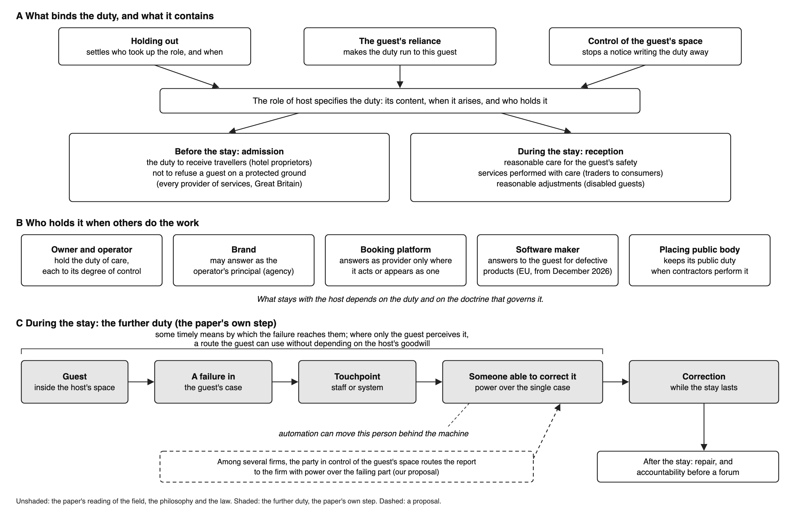

<!--
ASSEMBLED BY assemble_v8.py from v8_2026-11/LEDGER.md. DRAFTED BY CLAUDE (Opus 5.5), 13 Nov 2026, except Pierre's sentences, which DRAFT_v8_marked.md tags [PB] (verbatim) and [PB-a] (adapted). Delete this comment before submission.
-->

# Who hosts the guest? Algorithmic mediation, standing and responsibility in phygital hospitality

## Abstract

Commercial hosts increasingly hand parts of hosting, from room pricing to check-in, to algorithmic systems assembled from services supplied by several firms. Hospitality scholarship defines what a host owes and recognizes that hosting can be divided among multiple parties, yet it rarely specifies which party owes what. We argue that the role of host specifies the core duties: care for the guest's safety and diligent performance of what was undertaken. Holding out, guest reliance and control of the guest's space then bind those duties to a specific party. Where others carry out the work, what stays with the host depends on the duty at issue, and several parties may owe care at once. During the stay, the guest's claim also justifies a further duty to keep some timely route by which a failure in the guest's case reaches someone able to correct it, a person algorithmic mediation can move out of the guest's path. Drawing on hospitality studies, case law and empirical accounts of automated lodging, the article offers six questions for examining a touchpoint, states what the law requires and shows what hosts can do. [In phygital hospitality, interruptibility is the further duty's design consequence.]

<!-- The abstract is Roger's text (USER_ABSTRACT_2026-11-13.md), verbatim. The bracketed last sentence is Claude's proposal for the phygital positioning (D1), 11 words, bringing the abstract to 197 of 200; Roger keeps, rewrites or drops it. -->

**Keywords:** phygital hospitality; algorithmic mediation; host duties; standing; interruptibility; accountability

## INTRODUCTION

In nine family-run hotels in Europe, eight of them at resort destinations, an independent revenue-management company supplied the algorithm that recommended the price of every room for every night (Garcia et al. 2026). The manager kept the final decision, and could log in each day to see the recommended price beside the actual one and choose which prices to change. The managers changed prices only about once every 35 days, while the recommendations changed about once a week. The pricing architecture skewed its own recommendations because it counted on the managers to adjust them, and the authors call the recommendations 'strategically biased'. When a manager did change a price by hand, a change of one per cent in the recommendation moved the price charged by 0.72 per cent on average.

Now the other direction. Batat (2021) studied a restaurant attraction that also carries the guest across the physical and the digital: Le Petit Chef, a three-dimensional animated chef projected onto diners' tables. Its producers meant it 'to make the waiting moments in restaurants more pleasant', and diners needed no device and made no technological effort (Batat 2021: 4, 8). The staff did not withdraw: the projection broke the ice among diners and between diners and staff, and in one diner's account 'the atmosphere was great, the staff smiling' (Batat 2021: 7, 8). When a restaurant projects an animated chef onto diners' tables while human staff go on hosting the meal, the technology adds delight (Batat 2021) to an encounter whose rules, on our reading, stay steady and whose staff keep their discretion.

We open with these two cases because they show two sides of phygital hospitality: one moves a decision about the guest behind a system that another firm configures, the other adds to a welcome that the staff still give, and both carry the guest between the physical and the digital (Batat 2024: 1230–1231). The distinctive problem of phygital hospitality is not that another player has joined the game. It is that the party who makes the decision may no longer be the party who can answer for it.

Taken together, the two cases set the question this article takes up. Both raise the question of who, among the firms, staff and systems behind a stay, owes the guest what, and especially of whom the guest can reach when something goes wrong. Both also turn on a crossing between the physical and the digital. At the hotels the crossing ran through a model the guest never met, and the power to change its rule lay with another firm. At the table it ran through staff who stayed within reach. When the functions of hosting move into an algorithm, the obligation does not need to move into the machine. It needs to stay findable somewhere in the arrangement, attached to a real party who can be reached and who will answer for how the guest is received. The problem is not the missing human face. It is the missing answerable counterparty.

Hospitality now often runs through several firms at once, from the property that receives the guest, to the brand on its sign, to the platform that took the booking, to the vendor whose system set the price or opened the door (Slattery 2002: 24–25; Cobbe et al. 2023: 1187). At each of these firms a different party can answer the guest, or none can. Our focus in this article is on what a commercial host owes a guest, on what ground and held by whom, and specifically on lodging, but the argument reaches other phygital services where several firms stand behind one touchpoint. We argue that the role of host specifies the core duties, care for the guest's safety and care in performing what was undertaken, and that holding out, the guest's reliance and control of the guest's space bind those duties to a particular party. Where others do the work, what stays with the host depends on the duty at issue, and several parties may owe care at once. During the stay, the guest's claim justifies a further duty: to keep some timely route by which a failure in the guest's case reaches someone able to correct it.

The article begins by setting out phygital hospitality, the host, and the host's duty in law. After a note on our approach, it walks the phygital arrangement party by party, from the property to the brand, the platform, the vendor and the state. It then follows the duty through the stay and to the touchpoint, where we argue that the aim is not a seamless stay but an interruptible one, with a real person still within reach. We set aside whether a machine can itself owe a guest anything, since a robot can occupy a role without being a moral agent (Kropf et al. 2026: 7), and we leave aside guests who cannot report a failure and hosts who let rooms in their own homes.

## THEORETICAL CONTEXT

### *Phygital hospitality*

Automated check-in is perhaps the plainest example in hospitality of what Batat calls phygital: 'a holistic and integrative ecosystem that adopts a consumer standpoint as a starting point and then integrates a combination of physical, human, digital and media content elements' (2024: 1229). In other words, a phygital service joins physical and digital places, moves the guest between them, and promises, in her words, 'a coherent continuum in the delivery process of consumer value' across the move (2024: 1229). Phygital hospitality promises a smoother welcome: apps, algorithms, and smart interfaces that make a guest's stay faster, easier, and more personal.

Phygital hospitality refers both to these systems and to the arrangement of parties behind them, which we call a phygital arrangement, and we call any moment at which the guest meets that arrangement a touchpoint. The object of study is not the algorithm as a lone gadget. It is the whole arrangement, the socio-technical setup in which decisions, information, and power are spread across the guest, the employee, the property, the vendor who supplies the system, and whoever, in the corporate office or on the platform, sets its rules. Batat's latest work treats AI 'not as a functional tool but as an "experiential agent"' (2026: 17). We follow her in treating AI not as a neutral service tool but as a constitutive mediator of the hospitality relationship. Technology does not merely make an existing relationship faster; by redistributing knowledge, discretion, and authority, it can change the relationship itself (Casalegno et al. 2020).

This view draws on Jennie Germann Molz's 'network hospitality', in which performances of hosting and guesting become 'fluid and interchangeable', 'resulting in the phenomenon of "guests without hosts"' (2018: 231–232). Her study of Airbnb also found the platform's lawyers arguing that 'any penalty should be on the hosts renting out their homes, not on the company' (Mock, as quoted in Germann Molz 2018: 244). This journal has already asked what happens to hospitality when platforms push the human host out of view (Germann Molz 2026). That work asks what happens as the host is erased. We ask the next question. If a host can be erased because an algorithm now does the recognizing, the routing, and the admitting, what becomes of what the host owed?

Phygital hospitality has certain features. Physical moments are constantly turned into digital records, and digital rulings are constantly turned back into physical facts, a key card that works or does not, a price that appears on the screen at the desk. The frameworks call this movement fluidity (Batat and Hammedi 2023: 17; Batat 2024: 1220). It is just as accurate to call it a relay, and a relay raises a management question that the word fluidity hides: who holds the authority, and who keeps the room to use judgment, at each handoff? Studies of 'robotic hospitableness' test whether a robot can make guests feel welcomed, attended to, and reassured (Liu et al. 2026), and an emerging theory of AI consciousness asks whether guests can experience genuine hospitality from a machine at all (Lee and Lu 2024). Whether a party seems hospitable and whether it occupies a position that owes the guest something are two different matters, and only the second is independent of what the guest happens to believe. This means that a phygital arrangement can separate the party that decides from the party that answers, which brings phygital hospitality back to an older question: who is the host?

### *The host*

Phygital hospitality is bound up with what hospitality studies has long asked of the host, and above all with what a host owes the guest. Kevin O'Gorman's history of ancient hospitality records the host's duties to receive the guest, to protect him and, if need be, to represent him in court (2005: 144–145), though in Rome he finds these duties named only for private hospitality, not for the innkeeper (2007: 45). Morrison and O'Gorman carry the duty into business, listing among the principles of commercial hospitality that businesses are responsible for the health, safety and security of their guests, though they derived those principles from the Rule of St Benedict (2008: Figure 2). Telfer, as Hemmington reports her, holds that 'traditionally the most important responsibility of all was the guest's safety', a responsibility Hemmington finds the trade often overlooks (2007: 15). This journal has named the host's power as well: its founding editorial treats hospitality as a form of social control (Lynch et al. 2011), anthropologist Julian Pitt-Rivers finds that 'It is always the host who ordains, the guest who complies' (2012: 513), and Bulley follows that power past the threshold, into the management of guests already inside (2015). We read these accounts together as saying that the party who admits the guest takes on the guest's safety, and keeps power over the guest, for as long as the stay lasts. Hospitality is more than efficient service. Experience research in the phygital tradition gets close to this. It puts empathy, emotional connection, and the effort to understand the customer on their own terms at the heart of experience design (Batat 2019). Hospitality theory adds one observation: these are also the fingerprints of a relationship in which one party holds obligations towards the other, and that becomes urgent the moment the party doing the recognizing is no longer a person.

At first sight commercial hospitality looks like plain service, and its staff often describe it so: when Golubovskaya et al. asked twenty-two hotel frontline employees about their work, only six could define hospitality, and 'service' rather than 'hospitality' was their default perspective (2017: 1296). Critics have questioned whether a host who charges can be hospitable at all: commercial hospitality, Lashley observes, 'would be withdrawn if the payment could not be made' (2015: 5), and for Slattery 'The buyers are not guests, they are customers' (2002: 21). Service research has quietly handed the host's role to the employee (Odekerken-Schröder et al. 2022). But being an employee and being a host are not the same thing. This journal's own work divides the host as well: its founding editorial distinguishes micro-hosts from macro-hosts (Lynch et al. 2011), Bulley describes agencies in a refugee camp performing the role of an assembled host (2015), and Petie et al. find asylum seekers in hotels to have been guests of the hotel, its staff, housing contractors and the local community at once (2025). These accounts describe hosting divided among several parties, and none of them says which party owes the guest the host's duty.

We think it worth holding on to the word host. We are wary of what the word can hide, since a firm may present itself as a guest's host while another firm controls the space the guest sleeps in. But when we talk about the host of a stay that runs through several firms, we are not just choosing a label: we are talking about who owes the guest care, and who must answer when that care fails. Being a guest is not a measure of how good the service is. It is a position in a relationship, and that position comes with a particular kind of standing. To be a guest is to have standing, which we define as the recognized position from which a person can ask, object, request an exception, and expect someone to answer. What does the host owe the guest, and who is the host? These are questions of duty, not of manners.

Standing differs from consumer rights, procedural justice, contestability and customer participation. Consumer rights are entitlements you hold against a company whether or not anyone is there to honor them. Procedural justice is about how a person judges a process they have been put through. Contestability, at least as design work mostly uses it, is a feature of a system: a route by which a decision can be challenged. Customer participation is about the guest's own contribution to the service. Standing comes before all of these, and it is relational in a stricter sense. A guest has standing when their words count as a claim addressed to someone in the matching position of host, someone able to receive it as a claim and obliged to respond. The obligation to respond is the host's, and it rests on the role and on the three facts that bind it to a party, which we set out below; standing does not ground the duty but names what the guest has when the duty is met. It helps to keep four neighbouring words apart. Obligation is what the host owes the guest. Responsibility is about who carries the job of meeting that obligation. Authority is the power to change the decision, or the rule behind it. Accountability, or answerability, is the duty to explain and justify what was done to someone entitled to ask (Bovens 2007). In an ordinary face-to-face welcome these four sit in one person. Algorithmic mediation can pry these apart, so that the party with the authority is not the party who must answer. Welcome, in short, is recognition, admission, responsiveness, and the capacity for a negotiated exception, all held together.

Hospitality scholars Sharma and Mattila come nearest to the question: when a cooking robot's undercooked burgers make diners ill, they ask whether 'The restaurant company, the robotic manufacturer who provided the robot, or the algorithm creators who made it' should be blamed, or the manager on duty (2026: 911). They leave the answer to governance and risk management (2026: 904). Others prescribe the route a guest needs — 'a visible route to human assistance' in a phygital hotel (Suh et al. 2026: sec. 6), or 'an identifiable actor authorized to complete recovery', owned at the level of the organization the guest deals with (Ariyogi et al. 2026: 84, 79) — and service research gives the focal firm the governance of its ecosystem because it orchestrates the ecosystem (Wirtz et al. 2023). None of them derives what the guest is owed, or which of several firms owes it, from the role of host, and that is where the law of the host's duty comes in.

### *The host's duty in law*

What phygital research asks of hosts is in the end a question of duty, so we turn now to another body of scholarship: the law of the host's duty. A key statement of the duty is Blackstone's: one who 'hangs out a sign and opens his house for travellers' makes 'an implied engagement to entertain all persons who travel that way' (1768: 164), an undertaking the law implies although it was 'never perhaps actually made' (161–163). The Hotel Proprietors Act 1956 keeps the trigger: its hotel is an establishment 'held out by the proprietor' as offering food, drink and sleeping accommodation to travellers (s. 1(3)).

Three facts outside the role make its duty bind a particular party: holding out settles who took the role up and when, the guest's reliance makes the duty run to this guest, and control of the guest's space keeps the duty from being written away by notice or contract. Holding out, by which we mean presenting a house to travellers as open to receive them, is how a party takes the role up, and a modern English court reads it into negligence: the hotel 'invited guests to come and stay at the hotel and thereby assumed a duty to take reasonable care to protect guests' (Al-Najar 2019: para 187). Reliance makes the duty run to this guest: a nightclub's guest, the Court of Appeal held, 'relies on the competence and prudence of its management' (Everett 2011: para 31). The same court grounded the duty in control — 'The management is in control of the premises. It can regulate who enters' — and in occupiers' law, Lord Pearson held, 'The foundation of occupier's liability is occupational control' (Wheat v E Lacon 1966). No one of the three suffices alone: an undertaking binds a host only to what it undertook, reliance binds only towards those who relied, and dependence on its own falls on whoever can help (Jeske 2021: §§3–4; Habib 2022: §§3.3, 5.1). On our account, control joined to reliance carries the duty of care for the guest's person whatever the host undertook, which fits the law's refusal to let a trader exclude liability for negligently causing death or personal injury (Consumer Rights Act 2015, s. 65).

Against this stands the rule that one who engages an independent contractor does not, in general, answer for the contractor's wrongs (Barclays Bank v Various Claimants 2020: paras 7, 24, 27). Despite that rule, we are not convinced that the host disappears when others do the work. The statute still gives the innkeeper's duties to 'the proprietor' and to no other person; package law still makes the organiser answer for the travel services whoever performs them; and occupiers still owe care to the degree of their control (Hotel Proprietors Act 1956, s. 1(1); Directive (EU) 2015/2302, art. 13(1); Wheat v E Lacon 1966). Delegation does move some duties, and the claim that the work of hosting can be delegated while the duty cannot is true of some duties and not of others; which stay with the host?

Our aim is not to make law the ground of hospitality, but to read it as a record of what the role of host has been held to require. In other words, the duty of care stays with whoever controls the guest's space, and the guest is owed a way to reach whoever can put a failure right. We use the law, then, to find which party holds the duty when hosting runs through several firms.

## APPROACH

We came to the question by reading the phygital literature beside published cases of divided and automated hosting: the cases kept asking who answers the guest, and the literature kept prescribing safeguards without saying which of several firms owes them, or why the guest is owed them. The host was present in every case and absent as a party who owes. We then searched OpenAlex, Crossref, Semantic Scholar and the web in November 2026 for work that says which of several firms owes a guest what, and found the question posed but not answered from the role of host. We read judgments and statutes of England and Wales, Ireland, several United States jurisdictions and the European Union. And we read published studies of hosting that is divided or automated: automated hotels in China, short-term rentals, family-run hotels pricing by algorithm, and hotels housing people placed by the state. We take our cases from these studies and judgments rather than construct them.

Reading them, we found that what a host owed changed with the duty at issue and with who controlled the guest's space. This is a conceptual argument, and its cases illustrate its distinctions without testing them. In law, the further duty we propose is not yet required: the law we read gives guests remedies and disabled guests adjustments, and outside package travel and platforms it requires no general route to someone able to correct a failure. We read Raz and Telfer only as others report them, and the evidence that failures reach a host mainly through the guest comes from two small hotel studies. The cases are meant to illustrate, not to stand for a sample.

Our method is a conceptual reading of hospitality theory beside the law of delegation, in which each doctrine is taken as evidence of what the host's role has been held to require. Its premise is that a role specifies the content of a duty, the moment it arises and the party who holds it. The analysis therefore asks, at each party and each touchpoint, where the host's duty sits and whether a failure in a guest's case can reach someone able to correct it. We assume that the duty attaches to the role of host, which a firm can hold, and not to whoever stands in the lobby.

## THE PARTIES TO A PHYGITAL ARRANGEMENT

Yet the classical picture is of one host who holds the house, its rule and the guest's safety together (Pitt-Rivers 2012: 513–514). Traditional hospitality is a straight line: host and guest, where the one who receives you is the one you can address. Commercial hospitality bends the line, slipping the company and its employee between the guest and whoever sets the terms, so the person facing you is acting for an institution whose rules they did not write. Phygital hospitality bends it again, dropping an algorithm in between. Now the guest's claim has to travel down a chain, guest to employee to system to whoever configured the system, and at each link the person in front of them holds a little less of the authority their claim is really aimed at. The problem is not the length of the chain. It is a break in it: the point where the decision gets made can come apart from any point where the guest can be answered. We take the links in turn, starting with the property where the guest sleeps.

### *The property*

Much of the law of hospitality starts from the house itself. What the innkeeper received, Sandoval-Strausz writes, was the stranger's person and belongings, overnight, in a house that was not the stranger's own (2005: 62–63). A traveller wrongly refused by an inn could sue the innkeeper — 'His right, I think, is founded on the common law' (Constantine 1944: 708) — and the general duty to receive now attaches to a hotel's proprietor (Hotel Proprietors Act 1956, s. 1(1)), while every provider of a service to the public in Great Britain must not refuse it on a protected ground (Equality Act 2010, s. 29(1)). Once a guest is received, the host owes reasonable care for the guest's person, against the crimes of third parties as well (Al-Najar 2019: paras 187, 240). A trader must also perform a service 'with reasonable care and skill', and a consumer whose service falls short may require it performed again (Consumer Rights Act 2015, ss. 49, 55).

An occupier escapes answering for a contractor's faulty construction, maintenance or repair if it chose the contractor reasonably and took the steps it 'reasonably ought' to check the contractor and the work (Occupiers' Liability Act 1957, s. 2(4)(b)), and Lord Keith held that it need not supervise a contractor it reasonably thinks competent (Ferguson v Welsh 1987: 7). Two hospitality defendants escaped on that footing: a nightclub whose door staff came from a security contractor, and a leisure centre whose machines a contractor maintained (Naylor v Payling 2004: paras 19, 50; Maguire v Sefton 2006: para 30). A duty that cannot be discharged by choosing a careful contractor is, in the Supreme Court's word, 'exceptional' (Armes v Nottinghamshire 2017: para 32), and no case we read applies one to an adult hotel guest in England. What stays with a host that performs through others therefore depends on the duty, and on the doctrine that governs it.

Of a brewery-owned public house whose manager's wife took in paying summer guests, Lord Denning said that 'two or more may be "occupiers"', each owing care 'dependent on his degree of control' (Wheat v E Lacon 1966). And within the property, who holds the power to put a guest's case right? Where that power sits has always varied with the house: at a small hotel in Helsinki, reception staff could give discounts without asking anyone, hesitated to go beyond 10–20 per cent of the room rate, and did not know where their authority ended (Schumacher and Komppula 2016: 121–123). Reservation agents, too, keep a sanctioned latitude to accept a rate below what a revenue-management system prescribes, and how far they use it depends on how they expect management to view it (Bendoly 2013). Staff can be asked to satisfy a guest while no longer holding the controls that would let them do so, as drivers working for Uber found when the routing app left them 'little flexibility for the driver to adapt to special client requests' (Möhlmann et al. 2021: 2009).

At the property, then, the law finds the host's duties of admission, of care for the guest's person and of careful performance. It shows that control of the guest's space carries the duty of care even when contractors do the work, though not every duty, and that several may hold it at once. It also shows that the staff who face the guest may hold less power over the guest's case than the guest assumes.

### *The brand*

Hospitality research has rarely asked what a brand owes a guest at a hotel that another firm operates, though Ariyogi et al. rest a guest's recovery on how the guest evaluates 'the branded service organization' (2026: 78). In law a brand has answered where it controlled the operation or held itself out: a jury found a motel's franchisor vicariously liable through apparent agency, its 'significant degree of control over the operation' counting (Crinkley 1988: paras 9, 51); a brand may be the operator's principal where it has 'the right to exercise control over the daily operations' (Billops 1978: 198); and a brand that told the public it would find 'a certain level of service' could be liable to a guest (Orlando 1983: 494).

Brands have also escaped: where the licence required the operator to disclose itself and the guest had not chosen the motel for its brand, and where only logos and products showed the brand (Hayman v Ramada Inn 1987: 279; Mobil Oil v Bransford 1995: 120–121). Control and holding out decide these cases, not the name on the sign.

The brand, then, answers to the guest where it controls the operation or holds itself out as the provider, and escapes where it does neither. Holding out matters again where the guest books, and enters, through a platform.

### *The platform*

Platform accommodation showed an early version of the break, well before hotels automated their own desks. Research on Airbnb and its cousins has documented hosts straining to satisfy rating systems they cannot see (Cheng and Foley 2019), the platform's idea of hospitality shaping what hosts feel they must offer (Roelofsen and Minca 2018; Germann Molz 2018), and guests shut out on the basis of records they never wrote and cannot inspect (Edelman et al. 2017). In other words, who answers the guest is settled on the platform's terms, as the argument of Airbnb's lawyers quoted above shows.

In European law a booking platform is not the provider of a stay where the host sets the price and the platform does not select its hosts (Airbnb Ireland 2019: paras 56–57, 68). It loses its shield from consumer-law liability, however, where consumers would take it for the provider (Digital Services Act, art. 6(3)). On the ground the roles split further: Bosma found that 'host' names several roles on a rental platform, among them primary hosts, listing owners and co-hosts, and one co-host took her instructions from the app rather than from the owner (2022: 601). On the same platforms, self-check-in replaces the handover of keys (Bosma 2022: 605).

The platform, then, answers the guest as a host where it holds itself out as the provider, and otherwise the duty of care stays with whoever controls the space, even when an app directs the person in it. Behind the app, and behind the hotel's own systems, sits the vendor.

### *The vendor*

Our first scene showed such a vendor, whose model recommended every price while the manager kept the decision. As algorithms take on these jobs, three things get redistributed across the arrangement: knowledge, discretion, and authority. Knowledge is about who is placed to understand what is happening. Discretion is about who can depart from the prescribed answer. Authority is about who can change the rule itself, or answer for it. Discretion acts on the single case. Authority acts on the rule. At the hotels, authority over the pricing rule lay with the vendor while discretion over each price stayed with the manager, though the study observed managers, not guests. A guest can meet someone with the first power and never reach anyone with the second.

In the European Union, the manufacturer of defective software that injures a guest will answer to the guest directly, for products placed on the market after 9 December 2026, but not for a failure of performance that causes no listed damage (Directive (EU) 2024/2853, arts 2(1), 4(1), 5(1), 6(1), 8(1)(a)). Where several firms host together, each answers for its own part, and a loose collection of firms is not itself an agent (Kong 2026: 9; Pettit 2007: 195).

The vendor, then, holds authority over the rule and answers the guest only for listed damage, while the duty of care stays with the party in control of the guest's space. The party best placed to know, to decide, and to rewrite the rules may also be the party least available to answer the guest. We return to the vendor at the touchpoint, where a guest's report must reach it, but first to the state, which places some guests in hotels and pays for them.

### *The state*

The asylum seekers Petie et al. studied, guests of a hotel, its staff, housing contractors and the local community at once, were housed on a no-choice basis, and hotel staff became hosts almost overnight to people whose needs called for knowledge commercial hospitality does not usually require (2025).

Whose duty is it when the state places the guest? In England the placing minister's duty is a public one that 'remains hers' when contractors perform it (R (DMA) 2020: para 100), whereas a privately owned care home's duties to its residents are, in Lord Scott's words, 'governed by private law' (YL 2007: para 29). The Court of Appeal has since read R (DMA) as requiring a system to ensure that contractors performed the minister's duty, not a free-standing duty to monitor (RR v Enfield 2025: paras 80–81).

On these authorities, control of the guest's space carries the duty of care, and several parties may share it. Which party answers for the rest of what a guest is owed, among brand, platform and vendor, is a matter we can only propose. Outside package travel, neither the law of delegation nor its moral philosophy says that a host must keep a means of learning of a failure in the guest's case while it can still be put right: Brandt's delegator steps in only once the delegate is plainly failing, and leaves a means of finding out as one policy among several (Brandt 2017).

## DURING THE STAY

The scenes we began with hint at time as well: a price is set before arrival and a projection fills one wait, but a stay runs for nights, while the guest is inside the host's space. How long can a guest wait for a failure to be put right? For the length of the stay the guest is on the territory over which the host claims authority, and subject to the host's ordering of it (Pitt-Rivers 2012: 514). Leaving has a cost: an au pair told Moysidou and Stanley that she had not complained because she could not leave (2023). Once inside, Bulley observes, neither host nor guest can assert sovereignty without ending the relation (2015), and Moysidou and Stanley treat a guest's effective complaint as a form of power (2023). Whether a failure in the guest's case is put right then depends on whether it reaches someone able to put it right.

The guest has a claim to the host's performance: the host's legal duties are owed to the guest, who may sue on them, and on the standard account of rights a duty owed to someone is that person's claim (Wenar and Cruft 2025: §2.1.2). We argue, and this step is ours, that the claim justifies a further duty during the stay. In legal theory, Herstein reports, 'the same claim-right seemingly can count in favor of different and changing duties, for instance given changes in factual circumstances' (2023: §8.4), a view he traces to Raz. The facts that change here are delegation and automation: once performance runs through other firms and systems, meeting the guest's claim depends on the host's learning of a failure while it can still be corrected. An 'ought', Kiesewetter argues, transmits to the necessary means of doing what one ought to do (2015: 922), so the host owes some timely means of learning of failures and correcting them, though not any particular one.

Where only the guest perceives a failure, a route from the guest is itself one of those means. Hotels do learn of failures this way: a Helsinki hotel relied mainly on guests' feedback (Schumacher and Komppula 2016: 121), and at the automated hotels each guest the kiosk could not process went to find a worker (Xu and Greiffenhagen 2024: 5035). Not every guest reports, however: in restaurant experiments, customers who felt low in power complained less (Min and Kim 2020: 2), and a failure of the whole system needs no report at all (Xu and Greiffenhagen 2024: 5021). The evidence is thin, two small hotel studies, and it suggests that the guest's report is the main route for failures in the guest's own case, not the only one. Because the guest is subject to the host's power and leaving has a cost, the route must also be one the guest can use without depending on the host's goodwill.

We take the further duty to be owed to the guest, since the guest's claim justifies it, though Herstein reports that duties a right justifies as facts change arguably strain the correlation between rights and duties (2023: §8.4). It differs from Hindriks's 'duty of control', which he grounds partly in risk to others and does not say is owed to anyone (2025: 4–5), and from service recovery, which studies how a firm's response to complaints shapes complainants' satisfaction and loyalty (Gelbrich and Roschk 2011), since it binds where recovering a guest does not pay. A host that keeps no means of correction during the stay therefore wrongs its guests even if nothing fails. Design research has proposed such routes already (Ariyogi et al. 2026: 84; Suh et al. 2026: sec. 6); what we add is the ground on which the guest is owed one, and the party who owes it.

The further duty runs for the stay, as the guest's subjection does, and within the stay what the route carries is correction, by which we mean late performance or the repair of a lapse. After the stay, the guest's claims run to repair and to accountability, a party's capacity to demand answers and to impose sanctions (Fox 2007: 665). Baum and Laux find that only oversight acting before a decision takes effect can change that decision (2026: 120–122), and for hospitality we draw the boundary at correction: the route is owed while correction can still help the guest during the stay. Three laws put correction before money: remedy during a package trip, repeat performance of a consumer service, and rectification of a platform's decision about a worker, with compensation 'Where such rectification is not possible' (Directive (EU) 2015/2302, art. 13; Consumer Rights Act 2015, ss. 55, 56(3); Directive (EU) 2024/2831, art. 11(3)). Table 1 places common hospitality decisions against this boundary.

**Table 1.** Hospitality decisions by whether correction during the stay can still help, and the route each needs.

| Decision | When its effect lands | Can correction during the stay help? | Route the further duty asks for | Source |
|---|---|---|---|---|
| Refusal at arrival | Before reception | Yes, if someone can admit the guest that night | None from the further duty; the duty to receive (innkeepers) and the duty not to refuse on a protected ground (every provider) govern | Hotel Proprietors Act 1956, s. 1; Equality Act 2010, s. 29(1) |
| Identity or booking not recognized at check-in | At arrival | Yes | A worker or process able to override the system, reachable at once | Xu and Greiffenhagen 2024: 5035 |
| Danger on the premises | During the stay | Yes, while the guest is still exposed | A person on the spot with power to act | Our reading |
| A service in the room fails | During the stay | Yes | A route the guest is told of, ending with someone able to put it right that day | Our reading |
| A charge disputed during the stay | At payment | In part | A route during the stay; repair after it | Our reading |

The boundary also explains why we should read findings about 'guests accepting automation' with care. Guests may not mind whether a person or a robot hands them directions at an information desk, because little is at stake (Schmidt et al. 2025). The question is not whether guests prefer humans or machines in general. It is what authority and what consequences ride on this particular encounter. Friction, on this reading, is not a good in itself. It is the moment in time at which standing can be exercised.

## AT THE TOUCHPOINT

In phygital hospitality we must also attend to the touchpoint itself. The kiosk that reads a face, the code that opens a rental's door, the screen that shows a manager the recommended price: each is a crossing between the digital and the room the guest stands in. Like the parties and the stay, the touchpoint is where the duty is met or missed (Figure 1).

**Figure 1.** The host's duty, its holders, and the further duty during the stay.

This is perhaps clearest at automated check-in: at the two hotels in China that Xu and Greiffenhagen studied, service workers stayed on site 'for legal and technical reasons', though guests could register alone (2024: 5035). Guests walked past the worker to the kiosk, and a guest who approached the worker was sent back to 'do it yourself' (5022). Guests whom the kiosk could not process reached the worker only by seeking the worker out (5035). Automation moved the person with power behind the machine; it did not remove them. The route differs by format, from the Helsinki desk to the co-host's app, but the question put to each is the same: can a failure in a guest's case reach someone with power over it?

The end of the route need not always be a person: at the automated hotels most failures of face recognition were cured by guests trying again (5025, 5027, 5030). Where retrying cannot cure a failure, correction needs power to depart from what the system produced, as when a worker checked in by hand the 13 guests the kiosk could not process (5035). For failures of a documented type a reachable power to override is a precaution a host can foresee needing (Kong 2026: 6), and where no configured process covers a failure and the stakes warrant it, we ask for a natural person at the end of the route. From 2 December 2027, European law requires that high-risk AI systems listed in Annex III let their overseers 'disregard, override or reverse the output', and it leaves off that list systems that only confirm who a person is (Regulation (EU) 2024/1689, arts 14(4), 113, as amended by Regulation (EU) 2026/1744; Annex III, point 1(a)). The person at the end of the route owes the guest care in using that power: in Groh, guests told a hotel's guard 'We are drunk. We can't drive', and the hotel evicted them, and the court held that the duty of care governed how the stay ended (Westin Operator v Groh 2015: ¶¶ 4, 7).

The holder, for its part, owes the person at the end of the route real authority, which in the Helsinki hotel was unwritten. Keeping a human in the loop is not enough. An employee who can listen with great sympathy but cannot change anything becomes a place to deposit frustration, not a source of accountability (Sterz et al. 2024; Li and Sun 2025). Preserving a human face may matter less than preserving human authority. A route to someone without authority is not a route to correction, so the holder must give that person power in writing, the training to use it, and protection from becoming the object of the route. But there is a ceiling on what skill can do. Skill cannot conjure a counterparty. The distinction can be put in five words: competence is learned, standing is conferred. The holder must also learn across cases, since single reports can together signal a failure, as the UN Guiding Principles expect of any grievance channel (United Nations 2011: 32). Where several firms host together, we propose that the party in control of the guest's space routes a guest's report to the firm with power over the failing part, as Lord Denning said the occupiers on the spot should have reported a dangerous handrail to the brewery (Wheat v E Lacon 1966).

From these points we derive one test for researchers analysing a touchpoint and for hosts auditing one: can a failure in a guest's case reach, in time, someone able to correct it? The test puts its questions in the order a report travels:

1. Who perceives a failure in the guest's case: the guest, the staff or the system?
2. Is the guest told of a route, and can the guest use it without depending on the host's goodwill? What does refusing the system cost the guest?
3. Where does the route end, and can whoever is there depart from the system's output in this case? Who can override it?
4. Is that power real: written, supported by training, and protected?
5. Can the report arrive, and the correction be made, while the stay still allows it?
6. Does the holder learn across cases and, among several firms, does one party route the report?
7. After the stay, who must answer if it is disputed?

At the automated hotels the route ended in a worker able to override the kiosk, but a guest had to seek the worker out, so the touchpoint passes the third question and fails the second (Xu and Greiffenhagen 2024: 5021, 5035); in Groh the report reached guards with power over the case who used it against the guests, so it passes the third and fails the fourth (2015: ¶¶ 7–8, 36). A route can exist and still fail at a different question in each case, and the questions locate where.

The law sets a floor beneath the test: in the EU a solely automated decision with significant effects is in principle prohibited outside three exceptions (SCHUFA 2023: paras 52–53), platforms must keep a point of contact that does not 'solely rely on automated tools' (Digital Services Act, art. 12(1)), and in Great Britain a disabled guest whose only route is a kiosk or an app may be owed a reachable person (Equality Act 2010, s. 20(5), (6), (11)). Outside package travel, platform moderation and solely automated significant decisions, no law we read gives an accommodation guest a route to a natural person with power over the single case. Nor does a missing route add a head of liability, since a party that undertook a service answers for it with or without one (X v Kuoni 2021: para 50), and the Georgia court left a duty to check on guests to its legislature (Rasnick 2011: 569): in law the further duty is a proposal, for legislatures and for hosts' own practice.

This is also where the field's favourite word, seamlessness, needs a second look. Smoothness has become a central goal in accounts of phygital hospitality (Batat and Hammedi 2023; Batat 2024; Mameli et al. 2026): good technology strips out queues, repetition, uncertainty, and wasted effort so the guest glides through the journey. The field is not uncritical: Shabnam et al. question its 'dominant emphasis on efficiency and experience design' (2026: 2), and Batat rates hospitality systems that create 'seamless, efficient, and coherent phygital journeys' as 'good or fair', below what AI can add when it is aligned with human value (2026: 13, 16). Negotiation needs a moment in which negotiation can happen. A system built never to interrupt the guest can become a system the guest cannot interrupt. The opposite of frictionless hospitality is not friction-filled hospitality. It is interruptible hospitality. The goal is not friction but interruptibility: a point at which the guest can stop the process, ask, redirect, or be handled as an exception, and a counterparty there to catch the interruption. Continuity and trust across a crossing, which the phygital literature rightly seeks, require that whoever could answer the guest before the crossing can still be reached after it; interruptibility is the further duty's design consequence.

Explaining a decision where it lands, letting guests correct what a system got wrong and making rule changes visible improve the interaction. None of them decides who is answerable within it. An option that exists on paper but carries a heavy penalty, in money, effort, or embarrassment, is not a real alternative, and turning away from a service reached only through an app 'may carry a personal cost and loss' (Wilson-Nash et al. 2026: 979). A guest may not fit because of their body, their documents, their language, or simply their circumstances that day, and they then meet a system with no surface on which the misfit can be negotiated. We set these principles out in Table 2 as five stages a host can take in turn, the last being accountability after the stay before a forum that 'can pose questions and pass judgement' (Bovens 2007: 450). Such a forum is an institutional place where a claim can be made, someone is obliged to receive it, reasons can be asked for, authority exists to change an outcome, and responsibility is recorded. A small host meets these principles with a telephone number that the owner answers.

**Table 2.** Five stages from audit to accountability after the stay (the order is ours).

| Stage | What the host does | What it secures for the guest |
|---|---|---|
| 1. Examine | Puts the questions to each touchpoint | A map of where a failure in a guest's case can and cannot reach someone able to correct it |
| 2. Tell | Tells guests the route, in forms every guest can use | A route the guest knows of and can use without a confrontation |
| 3. Empower | Gives the person at the route's end power in writing, training and protection | Someone able to correct the failure in the guest's case |
| 4. Learn and route | Reads reports across cases; among several firms, one party routes each report | Correction of patterns, and of failures in another firm's part |
| 5. Answer | Answers after the stay before a forum that can question and judge | Accountability for what was not corrected |

## CONCLUSION

In this article we have argued, first, that the role of host specifies what a commercial host owes, care for the guest's safety and care in performing what was undertaken, and that holding out, reliance and control bind that duty to a particular party. Second, what stays with the host when others do the work depends on the duty, and the duty of care may lie with several parties at once, each to its degree of control. Third, and this step is ours, during the stay the guest's claim justifies a further duty, owed to the guest, to keep some timely route by which a failure in the guest's case reaches someone able to correct it. We have seen how algorithmic mediation leaves the host's duties in place and can move the person able to correct a failure behind the machine, as it did at the automated hotels in China.

None of this is a case against the technology. Phygital arrangements deliver real gains in responsiveness, and in how much a small team can offer a large number of guests. For staff the gains come with costs: experts expect algorithmic management to raise efficiency in hotels and to intensify work (Jianu et al. 2025: 1, 6). Guest-centred phygital hospitality does not depend on making technology invisible, and good hospitality does not require every encounter to stay human. Human-centricity, on this account, concerns whether a guest can bring a failure to someone able to correct it, and whether that person holds the power to correct it. That is the missing answerable counterparty with which we began, and the further duty is what supplies it.

So, the real question for phygital hospitality is not whether technology can perform the jobs a host used to perform. Increasingly, it plainly can. The harder question is where, in an arrangement that has scattered those jobs across guest, employee, vendor, and platform, the obligation of hosting still has an address. When the jobs move but the obligation is left without one, hospitality is not lost because a machine replaced a person. It is lost because the guest has been left with no one to answer them.

The parties meet at one touchpoint, but each owes the guest something different. We have seen how the property owes care because it controls the space the guest sleeps in; how a brand answers where it controls the operation or holds itself out; how a platform answers only where it presents itself as the provider; how a vendor holds the rule and answers the guest for injury alone; and how the state's duty to a guest it places remains its own.

Soft law and scholarship come close: the UN Guiding Principles ask for grievance channels open directly to those a business may harm (United Nations 2011: 31–32), the White House Office of Science and Technology Policy asks for 'access to a person who can quickly consider and remedy problems' (2022: 46), and Binesh and Syah hold that protecting guests' autonomy requires 'real human override at the service encounter' (2026: 10). In the literature we searched, we found no work that derives a guest's route to correction from the duty a host owes the guest, and that derivation, with the party in control of the space as the party who owes it, is what this article adds. Germann Molz asked in this journal whether platforms 'are held accountable' (2018: 246); for a guest inside the host's space, our answer runs through control of that space.

Four studies would test the argument where it is thinnest: how often hotel guests report a failure during the stay, to whom and by what route; whether recovery after a self-service or robot failure differs with and without an employee the guest can reach; how a guest's report travels through unstaffed hotels and self-check-in rentals, and how long correction takes; and, in law, whether courts would count the lack of any route as a want of care. The further duty asks for correction during the stay and leaves disputed complaints to be judged by others, since a business 'cannot, with legitimacy, both be the subject of complaints and unilaterally determine their outcome' (United Nations 2011: 35).

A host can act on the argument now, by putting the questions to each touchpoint and telling guests, in forms every guest can use, whom to reach and how. Guests need a moment where a decision can be questioned. Employees need enough authority to respond. Organizations need to accept responsibility for the rules their automated systems apply. The question for phygital hospitality is whether, in arrangements that spread a host's work across staff, firms and systems, a failure in a guest's case can still reach someone able to correct it. However smart, however personalized, however seamless the technology becomes, somebody still owes the guest a welcome.

## Acknowledgment of the Use of Generative AI and AI-Assisted Technologies in the Writing Process

Throughout the preparation of this work, the authors employed Claude (Anthropic; Fable 5.2 and Opus 5.5) to search for and read sources, check citations and quotations, and draft the revised article and the responses to reviewers. Following the utilization of this tool/service, the authors thoroughly reviewed and edited the content as necessary, assuming full responsibility for the publication's content.

## References

Ariyogi, Dila, Mulyawan, Ulfan and Junita, Mawar (2026), 'From AI disclosure to human handoff: Transparency, trust, and accountability in automated hospitality services—A structured evidence review', *Global Review of Tourism and Social Sciences*, 3:1, pp. 77–90.

Batat, Wided (2019), *Experiential marketing: Consumer behavior, customer experience and the 7Es*, London: Routledge.

Batat, Wided (2021), 'How augmented reality (AR) is transforming the restaurant sector: Investigating the impact of "Le Petit Chef" on customers' dining experiences', *Technological Forecasting and Social Change*, 172, 121013.

Batat, Wided (2024), 'What does phygital really mean? A conceptual introduction to the phygital customer experience (PH-CX) framework', *Journal of Strategic Marketing*, 32:8, pp. 1220–1243.

Batat, Wided (2026a), 'Phygital service research (PSR): Advancing FSR and TSR toward human-first experience design in hybrid physical-digital ecosystems', *Journal of Services Marketing*, 40:4, pp. 505–518.

Batat, Wided (2026b), 'The phygital intelligence value experience (PHIVE) matrix: The good, the bad, and the ugly of AI marketing for customer experience design', *Journal of Strategic Marketing*, pp. 1–21.

Batat, Wided and Hammedi, Wafa (2023), 'The extended reality technology (ERT) framework for designing customer and service experiences in phygital settings: A service research agenda', *Journal of Service Management*, 34:1, pp. 10–33.

Baum, Kevin and Laux, Johann (2026), 'Constitutive vs. corrective: A causal taxonomy of human runtime involvement in AI systems', in *Bridging the Gap Between AI and Reality*, Cham: Springer Nature Switzerland, pp. 115–130.

Bendoly, Elliot (2013), 'Real-time feedback and booking behavior in the hospitality industry: Moderating the balance between imperfect judgment and imperfect prescription', *Journal of Operations Management*, 31:1–2, pp. 62–71.

Binesh, Nasim and Syah, Ahmad (2026), 'AI ethics in hospitality and tourism: Theoretical perspectives, ethical beliefs, and actionable outcomes', *Frontiers in Artificial Intelligence*, 9, 1913343.

Blackstone, William (1768), *Commentaries on the laws of England*, Oxford: Clarendon Press.

Bosma, Jelke R. (2022), 'Platformed professionalization: Labor, assets, and earning a livelihood through Airbnb', *Environment and Planning A: Economy and Space*, 54:4, pp. 595–610.

Bovens, Mark (2007), 'Analysing and assessing accountability: A conceptual framework', *European Law Journal*, 13:4, pp. 447–468.

Brandt, Reuven (2017), 'The transfer and delegation of responsibilities for genetic offspring in gamete provision', *Journal of Applied Philosophy*, 34:5, pp. 665–678.

Bulley, Dan (2015), 'Ethics, power and space: International hospitality beyond Derrida', *Hospitality & Society*, 5:2–3, pp. 185–201.

Casalegno, Cecilia, Civera, Chiara, Mosca, Fabrizio and Freeman, R. Edward (2020), 'Circular economy and relationship-based view', *Symphonya. Emerging Issues in Management*, pp. 149–164.

Cheng, Mingming and Foley, Carmel (2019), 'Algorithmic management: The case of Airbnb', *International Journal of Hospitality Management*, 83, pp. 33–36.

Cobbe, Jennifer, Veale, Michael and Singh, Jatinder (2023), 'Understanding accountability in algorithmic supply chains', *Proceedings of the 2023 ACM Conference on Fairness, Accountability, and Transparency (FAccT '23)*, pp. 1186–1197.

Edelman, Benjamin, Luca, Michael and Svirsky, Dan (2017), 'Racial discrimination in the sharing economy: Evidence from a field experiment', *American Economic Journal: Applied Economics*, 9:2, pp. 1–22.

Fox, Jonathan (2007), 'The uncertain relationship between transparency and accountability', *Development in Practice*, 17:4–5, pp. 663–671.

Garcia, Daniel, Tolvanen, Juha and Wagner, Alexander K. (2026), 'Strategic responses to algorithmic recommendations: Evidence from hotel pricing', *Management Science*, 72:1, pp. 609–626.

Gelbrich, Katja and Roschk, Holger (2011), 'A meta-analysis of organizational complaint handling and customer responses', *Journal of Service Research*, 14:1, pp. 24–43.

Germann Molz, Jennie (2018), 'Discourses of scale in network hospitality: From the Airbnb home to the global imaginary of "belong anywhere"', *Hospitality & Society*, 8:3, pp. 229–251.

Germann Molz, Jennie (2026), 'Guests without hosts: On the digital biopolitics of network hospitality', *Hospitality & Society*, 16:1, pp. 63–82.

Golubovskaya, Maria, Robinson, Richard N.S. and Solnet, David (2017), 'The meaning of hospitality: do employees understand?', *International Journal of Contemporary Hospitality Management*, 29:5, pp. 1282–1304.

Habib, Allen (2022), 'Promises', in Zalta, Edward N. and Nodelman, Uri (eds), *The Stanford Encyclopedia of Philosophy*, Metaphysics Research Lab, Stanford University.

Hemmington, Nigel (2007), 'From service to experience: Understanding and defining the hospitality business', *The Service Industries Journal*, 27:6, pp. 747–755.

Herstein, Ori (2023), 'Legal rights', in Zalta, Edward N. and Nodelman, Uri (eds), *The Stanford Encyclopedia of Philosophy*, Metaphysics Research Lab, Stanford University.

Hindriks, Frank A. (2025), 'The moral failures of collective agents: responsibility voids and control gaps', *Synthese*, 205:4.

Jeske, Diane (2021), 'Special obligations', in Zalta, Edward N. (ed.), *The Stanford Encyclopedia of Philosophy*, Metaphysics Research Lab, Stanford University.

Jianu, Brana, Ashton, Mark and Lugosi, Peter (2025), 'Integrating algorithmic management in hotels: Emerging challenges and opportunities for frontline managers', *International Journal of Hospitality Management*, 129, 104168.

Kiesewetter, Benjamin (2015), 'Instrumental normativity: In defense of the transmission principle', *Ethics*, 125:4, pp. 921–946.

Kong, Kennedy Chun Yin (2026), 'The delegation illusion: why deploying autonomous AI agents does not diminish principal responsibility', *AI and Ethics*, 6:5, 518.

Kropf, Mario, Spöck, Christoph and Werner, Roman (2026), 'Blame the robot: Role responsibility and ethical issues regarding AI-based care robots', *International Journal of Social Robotics*, 18:2, 30.

Lashley, Conrad (2015), 'Hospitality and hospitableness', *Research in Hospitality Management*, 5:1, pp. 1–7.

Lee, Wangoo and Lu, Lu (2024), 'The hospitable thought that counts: An emerging theory of "AI consciousness" in genuine hospitality', *International Journal of Hospitality Management*, 123, 103928.

Li, Huanhuan and Sun, Zongfeng (2025), 'Is algorithmic accessibility sufficient? The pivotal role of accessibility and accountability in shaping trust in automated decision-making', *Governance*, 38:4, e70067.

Liu, Gus Guanrong, Benckendorff, Pierre and Walters, Gabby (2026), 'Conceptualizing hospitableness in human-robot hospitality interactions', *International Journal of Hospitality Management*, 135, 104640.

Lynch, Paul, Germann Molz, Jennie, McIntosh, Alison, Lugosi, Peter and Lashley, Conrad (2011), 'Theorizing hospitality', *Hospitality & Society*, 1:1, pp. 3–24.

Mameli, Elisa, Scarles, Caroline, Stangl, Brigitte and Frohlich, David (2026), 'A comprehensive framework for phygital tourism experiences: Bridging academic insights and industry practices across sectors', *Information Technology & Tourism*, 28:1, 19.

Min, Hyounae (Kelly) and Kim, Hyun Jeong (2020), 'Do all angry customers complain?', *ICHRIE Research Reports*, 5:1.

Möhlmann, Mareike, Zalmanson, Lior, Henfridsson, Ola and Gregory, Robert Wayne (2021), 'Algorithmic management of work on online labor platforms: When matching meets control', *MIS Quarterly*, 45:4, pp. 1999–2022.

Morrison, Alison and O'Gorman, Kevin (2008), 'Hospitality studies and hospitality management: A symbiotic relationship', *International Journal of Hospitality Management*, 27:2, pp. 214–221.

Moysidou, Gesthimani and Stanley, Phiona (2023), 'Theorizing gender in homestay settings: Mobilities and/as power relations', *Hospitality & Society*, 13:3, pp. 241–263.

O'Gorman, Kevin D. (2005), 'Modern hospitality: Lessons from the past', *Journal of Hospitality and Tourism Management*, 12:2, pp. 141–151.

O'Gorman, Kevin D. (2007), 'Discovering commercial hospitality in ancient Rome', *Hospitality Review*, 9:2, pp. 44–52.

Odekerken-Schröder, Gaby, Mennens, Kars, Steins, Mark and Mahr, Dominik (2022), 'The service triad: An empirical study of service robots, customers and frontline employees', *Journal of Service Management*, 33:2, pp. 246–292.

Petie, Olivia, Phillimore, Jenny and Allsopp, Jennifer (2025), 'Exploring hospitality, hostility and (un)home in hotel accommodation for asylum seekers in the United Kingdom', *Hospitality & Society*, 15:1, pp. 23–44.

Pettit, Philip (2007), 'Responsibility incorporated', *Ethics*, 117:2, pp. 171–201.

Pitt-Rivers, Julian (2012), 'The law of hospitality', *HAU: Journal of Ethnographic Theory*, 2:1, pp. 501–517.

Roelofsen, Maartje and Minca, Claudio (2018), 'The superhost: Biopolitics, home and community in the Airbnb dream-world of global hospitality', *Geoforum*, 91, pp. 170–181.

Sandoval-Strausz, A. K. (2005), 'Travelers, strangers, and Jim Crow: Law, public accommodations, and civil rights in America', *Law and History Review*, 23:1, pp. 53–94.

Schmidt, Alexander Lennart, Koerten, Klaas, Tuomi, Aarni, El-Manstrly, Dahlia and Wiegerink, Karoline (2025), 'Human versus robot: Comparing service agents in hospitality settings — insights from a field study', *Strategic Change*, 34:4, pp. 559–575.

Schumacher, Satu and Komppula, Raija (2016), 'A case study on service recovery: Frontline employees' perspectives and the role of empowerment', *European Journal of Tourism, Hospitality and Recreation*, 7:2, pp. 117–127.

Shabnam, Saadia, Roy, Sanjit Kumar, Roten, Yonathan Silvain, Singh, Gaganpreet, Suh, Taewon and Li, Hairong (2026), 'Transformative phygital service research (TPSR): An agenda for future research', *Journal of Services Marketing*, pp. 1–17.

Sharma, Amit and Mattila, Anna S. (2026), 'Rights and responsibilities of hospitality service robots', *Journal of Hospitality & Tourism Research*, 50:6, pp. 904–920.

Slattery, Paul (2002), 'Finding the hospitality industry', *The Journal of Hospitality Leisure Sport and Tourism*, 1:1, pp. 19–28.

Sterz, Sarah, Baum, Kevin, Biewer, Sebastian, Hermanns, Holger, Lauber-Rönsberg, Anne, Meinel, Philip and Langer, Markus (2024), 'On the quest for effectiveness in human oversight: Interdisciplinary perspectives', *Proceedings of the 2024 ACM Conference on Fairness, Accountability, and Transparency*, pp. 2495–2507.

Suh, Taewon, Nasta, Luigi, Pirolo, Luca and Magnanelli, Barbara Sveva (2026), 'Phygital customer experience and the adoption of immersive technologies in hospitality: An exploratory study with a value co-creation perspective', *Journal of Services Marketing*, pp. 1–18.

United Nations, Office of the High Commissioner for Human Rights (2011), *Guiding principles on business and human rights: Implementing the United Nations "protect, respect and remedy" framework*, https://www.ohchr.org/sites/default/files/documents/publications/guidingprinciplesbusinesshr_en.pdf.

Wenar, Leif and Cruft, Rowan (2025), 'Rights', in Zalta, Edward N. and Nodelman, Uri (eds), *The Stanford Encyclopedia of Philosophy*, Metaphysics Research Lab, Stanford University.

White House Office of Science and Technology Policy (2022), *Blueprint for an AI bill of rights: Making automated systems work for the American people*, The White House, https://bidenwhitehouse.archives.gov/wp-content/uploads/2022/10/Blueprint-for-an-AI-Bill-of-Rights.pdf.

Wilson-Nash, Carolyn, Angell, Rob, Qiu, Yuanming, Pavlopoulou, Ismini and Kolyperas, Dimitrios (2026), 'No app, no entry: Conceptualizing digital technology captivity in service access', *Psychology & Marketing*, 43:5, pp. 974–985.

Wirtz, Jochen, Kunz, Werner H., Hartley, Nicole and Tarbit, James (2023), 'Corporate digital responsibility in service firms and their ecosystems', *Journal of Service Research*, 26:2, pp. 173–190.

Xu, Xinzhi and Greiffenhagen, Christian (2024), 'The disciplined customer: A video-based study of automated self-service hotels', *New Media & Society*, 26:9, pp. 5013–5038.

### Cases

Airbnb Ireland (2019), Case C-390/18, criminal proceedings against X (Airbnb Ireland), judgment of the Court (Grand Chamber) of 19 December 2019.

Al-Najar v The Cumberland Hotel (London) Ltd [2019] EWHC 1593 (QB).

Armes v Nottinghamshire County Council [2017] UKSC 60.

Barclays Bank plc v Various Claimants [2020] UKSC 13.

Billops v Magness Construction Co (1978) 391 A.2d 196 (Del.).

Constantine v Imperial Hotels Ltd [1944] 1 KB 693.

Crinkley v Holiday Inns, Inc (1988) 844 F.2d 156 (4th Cir.).

Everett v Comojo (UK) Ltd [2011] EWCA Civ 13, [2012] 1 WLR 150.

Ferguson v Welsh [1987] UKHL 14, [1987] 1 WLR 1553.

Hayman v Ramada Inn, Inc (1987) 86 N.C. App. 274.

Maguire v Sefton Metropolitan Borough Council [2006] EWCA Civ 316.

Mobil Oil Corp v Bransford (1995) 648 So. 2d 119 (Fla.).

Naylor (t/a Mainstreet) v Payling [2004] EWCA Civ 560.

Orlando Executive Park, Inc v Robbins (1983) 433 So. 2d 491 (Fla.).

R (DMA) v Secretary of State for the Home Department [2020] EWHC 3416 (Admin).

R (RR) v London Borough of Enfield [2025] EWCA Civ 1390.

Rasnick v Krishna Hospitality, Inc (2011) 289 Ga. 565, 713 S.E.2d 835.

SCHUFA: OQ v Land Hessen (2023), Case C-634/21, judgment of the Court (First Chamber) of 7 December 2023.

Westin Operator, LLC v Groh 2015 CO 25, 347 P.3d 606 (Colo.).

Wheat v E Lacon & Co Ltd [1966] UKHL 1, [1966] AC 552.

X v Kuoni Travel Ltd [2021] UKSC 34.

YL v Birmingham City Council [2007] UKHL 27.

### Legislation and other legal sources

Consumer Rights Act 2015 (c. 15).

Directive (EU) 2015/2302 of the European Parliament and of the Council of 25 November 2015 on package travel and linked travel arrangements.

Directive (EU) 2024/2831 of the European Parliament and of the Council of 23 October 2024 on improving working conditions in platform work.

Directive (EU) 2024/2853 of the European Parliament and of the Council of 23 October 2024 on liability for defective products.

Equality Act 2010 (c. 15).

Hotel Proprietors Act 1956 (4 & 5 Eliz. 2 c. 62).

Occupiers' Liability Act 1957 (5 & 6 Eliz. 2 c. 31).

Regulation (EU) 2022/2065 of the European Parliament and of the Council of 19 October 2022 on a Single Market for Digital Services (Digital Services Act).

Regulation (EU) 2024/1689 of the European Parliament and of the Council of 13 June 2024 laying down harmonised rules on artificial intelligence (Artificial Intelligence Act), OJ L, 12.7.2024.

Regulation (EU) 2026/1744 of the European Parliament and of the Council of 8 July 2026 amending Regulations (EU) 2024/1689, (EU) 2018/1139 and (EU) 2023/1230 as regards the simplification of the implementation of harmonised rules on artificial intelligence (Digital Omnibus on AI).
